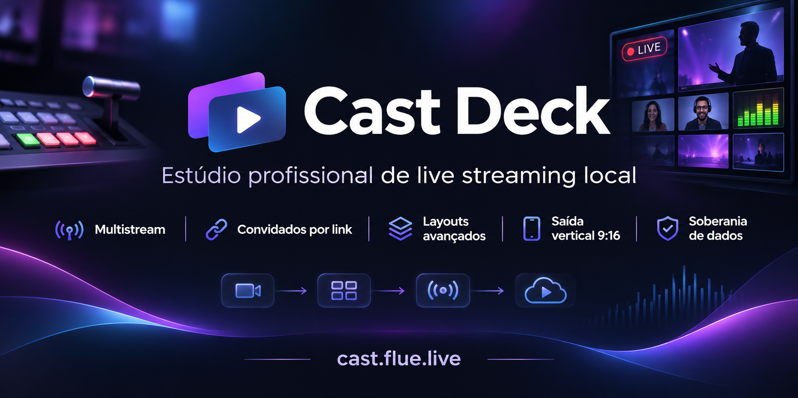

<div align="center">


# CastDeck Local

**Tu estudio de directo en tu propia computadora — con la videollamada en el centro.**

Una alternativa a StreamYard para quien quiere invitados por enlace, escenas profesionales, grabación local
y multistream sin depender de una suscripción en la nube.

[](LICENSE)
[](#descargas)
[](package.json)
[](https://github.com/aloproducao2/castdeck-local/actions/workflows/ci.yml)
[](CONTRIBUTING.md)

[**Descargar**](https://cast.flue.live/downloads.html) ·
[**Alternativa a StreamYard**](docs/streamyard-alternative.es.md) ·
[**Documentación**](docs/DOCUMENTACAO.md) ·
[**Português**](README.pt.md) · [**Apoya el proyecto**](https://apoia.se/casdecklocal) · [**English**](README.md)

<a href="https://www.producthunt.com/products/castdeck-local?embed=true&amp;utm_source=badge-featured&amp;utm_medium=badge&amp;utm_campaign=badge-castdeck-local" target="_blank" rel="noopener noreferrer"></a>

<a href="https://cast.flue.live"></a>

</div>


## Por qué CastDeck

CastDeck parte de una idea simple: **la videollamada es el corazón del directo**, pero el estudio no tiene
que estar en la nube. Abre CastDeck en tu PC, invita a las personas con un enlace y opera todo —cámaras,
audio, escenas, gráficos, replay y transmisión— desde un solo lugar.

| | Estudios en la nube | **CastDeck Local** |
|---|---|---|
| Dónde se compone el vídeo | servidores del proveedor | **tu computadora** |
| Invitados | cuenta/app del servicio | **navegador, sin instalar** |
| Grabación | según el plan | **MP4 local** |
| Salidas | plataformas del plan | **RTMP/RTMPS/SRT donde quieras** |
| Vertical 9:16 | extra/plan | **simultáneo e independiente** |
| Coste | suscripción | **gratis y abierto (AGPL-3.0)** |
| Código | cerrado | **auditable y modificable** |

> StreamYard es una marca de sus respectivos propietarios. Esta es una comparación independiente, sin
> afiliación.

## La videollamada primero

- **Invita por enlace.** El invitado entra desde Chrome/Edge en el móvil o PC, sin crear cuenta ni instalar.
- **Mix-minus real.** Cada persona escucha el programa sin oír su propia voz; la conversación fluye.
- **El invitado ve el programa.** Sigue la escena en vivo, no solo su propia cámara.
- **Anfitrión + invitados en el escenario**, con layouts de 1 a 4+ y cambio con un clic.
- **Compartir pantalla, pestaña y medios** para entrevistas, clases, podcasts y coberturas.
- **Modo vertical 9:16** con layout propio y grabación separada para TikTok/Reels/Shorts.

## En el aire en un minuto

1. **Descarga y abre** CastDeck (Windows, Linux, macOS o Android).
2. Crea un estudio y pulsa **Invitar** — copia el enlace y envíalo.
3. Añade tus destinos (YouTube, Twitch, Facebook, RTMP/SRT) y pulsa **Transmitir**.

Sin login, sin tarjeta y sin mensualidad. FFmpeg y cloudflared vienen incluidos en el ejecutable.

## Funciones que marcan la diferencia

| 🎥 **Producción** | 🎙️ **Audio** | 📺 **Entrega** |
|---|---|---|
| Escenas, layouts y transiciones | Mezclador con faders y VU en dBFS | Multistream RTMP/RTMPS/SRT |
| Preview y PGM independientes | Mix-minus y reducción de ruido | Grabación MP4 local ilimitada |
| GC de telediario y banners | Buses A–G y monitorización | 16:9 y 9:16 al mismo tiempo |
| Replay & VAR con IN/OUT | Música, medios y jingles | Replay, stinger y cámara lenta |
| Overlays y galería de imágenes | Talkback e invitados | Control remoto desde el móvil |
| Subtítulos en vivo (Whisper/Parakeet) | Audio del sistema e invitados | Android como cámara/control |

## Comparación honesta

**StreamYard** es una gran opción cuando quieres una sala totalmente gestionada en la nube, sin instalación y
con soporte del proveedor. **CastDeck** propone otro equilibrio:

| Pregunta | StreamYard (SaaS) | CastDeck Local |
|---|---|---|
| Quiero procesar y grabar en mi PC | no | **sí** |
| Quiero invitados sin cuenta/app | sí | **sí** |
| Quiero multistream sin límites de plan | plan | **sí** |
| Quiero código abierto y auditable | no | **sí** |
| Quiero soporte oficial 24/7 | sí | **comunidad** |
| Quiero usarlo sin instalar nada | sí | **app local (o Android)** |

**Elige CastDeck si** te importan privacidad, coste previsible, grabación local, vertical simultáneo y
control del código. **Elige StreamYard si** necesitas una operación totalmente gestionada, soporte
contractual y no quieres administrar una computadora.

Lee el análisis completo: [**CastDeck como alternativa a StreamYard**](docs/streamyard-alternative.es.md)
(también en [Português](docs/streamyard-alternative.pt-BR.md) e [English](docs/streamyard-alternative.en.md)).

## Descargas

| Sistema | Cómo obtenerlo |
|---|---|
| **Windows 10/11 x64** | [cast.flue.live/downloads.html](https://cast.flue.live/downloads.html) |
| **Android 8+** | APK oficial en el sitio |
| **Linux x64/arm64** | binario/AppImage en el sitio |
| **macOS Intel/Apple Silicon** | binario en el sitio |

> macOS sin firmar: en el primer inicio usa **clic derecho → Abrir**.
> Requisitos: Windows 10/11, Linux o macOS; Chrome/Edge para la interfaz; 8 GB de RAM recomendados.

## Cómo funciona

```text
Navegador del anfitrión ──HTTP/WS──► Servidor local (Node) ──► FFmpeg ──► YouTube/Twitch/RTMP
          │                                  │
          │ WebRTC                           ├─ invitados (navegador, mix-minus)
          ▼                                  ├─ MediaMTX (RTMP/SRT de drones/cámaras)
   Canvas/Compositor ◄── escenas, gráficos, overlays, replay
```

- **Servidor local** Express/WebSocket en `127.0.0.1`/LAN.
- **WebRTC** para invitados, con TURN opcional para NAT difícil.
- **FFmpeg** para composición/grabación/RTMP; **MediaMTX** para ingesta.
- **Interfaz web sin framework**, servida por la propia app.

## Privacidad y seguridad

El vídeo y el audio del estudio permanecen en tu dispositivo. La app consulta el sitio solo para verificar
actualizaciones; no envía el contenido del directo a CastDeck. Lee [`SECURITY.md`](SECURITY.md) y
[`PRIVACY.md`](PRIVACY.md). Para vulnerabilidades, usa el canal privado — no abras un issue público.

## Apoya el proyecto

CastDeck es gratuito e independiente. Si te ayuda en tu producción, puedes apoyar el proyecto en
[Apoia.se](https://apoia.se/casdecklocal) — ayuda a cubrir servidores, dispositivos y tiempo de desarrollo.

## Licencia y comunidad

CastDeck es **software libre bajo AGPL-3.0-only**, con una **licencia comercial opcional** para incorporar
el código en productos cerrados. Los componentes de terceros mantienen sus licencias; consulta
[`THIRD-PARTY-NOTICES.md`](THIRD-PARTY-NOTICES.md) y [`licenses/`](licenses/).

- [`CONTRIBUTING.md`](CONTRIBUTING.md) — CLA y reglas de contribución
- [`CLA.md`](CLA.md) — acuerdo de contribución
- [`TRADEMARK.md`](TRADEMARK.md) — uso de la marca
- [`SOURCE-OFFER.md`](SOURCE-OFFER.md) — código fuente correspondiente
- [`COMMERCIAL-LICENSE.md`](COMMERCIAL-LICENSE.md) — licencia comercial

## Estado

Versión **1.4.3** — fuente Browser CEF en Windows con audio, 4K, scroll, idioma de la UI y adblock.
[releases](https://github.com/aloproducao2/castdeck-local/releases).

Hecho por **Miguel Kallemback / flue.live**, de Brasil para el mundo. 🌎
