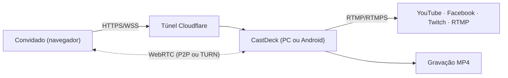

<div align="center">

# 🎙️ CastDeck Local

**Estúdio de transmissão ao vivo que roda no seu PC ou celular.**
Uma alternativa local, aberta e sem mensalidade aos estúdios de live na nuvem.


Convidados pelo navegador · Cenas com sua marca · GC e Jornal · Replay & VAR · Overlays com galeria · Multistream · Modo vertical 9:16

</div>

---

## Índice

- [Por que o CastDeck](#por-que-o-castdeck)
- [Começando em 1 minuto](#começando-em-1-minuto)
- [Downloads](#downloads)
- [Recursos](#recursos)
- [Como funciona](#como-funciona)
- [Android](#android)
- [Guia de recursos](#guia-de-recursos)
- [Conexão e rede](#conexão-e-rede)
- [Segurança](#segurança)
- [Solução de problemas](#solução-de-problemas)
- [Limites conhecidos](#limites-conhecidos)
- [Desenvolvimento](#desenvolvimento)
- [Testes](#testes)
- [Créditos](#créditos)

> 📘 Documentação técnica completa (arquitetura, protocolo, API, segurança, roadmap): [`docs/DOCUMENTACAO.md`](docs/DOCUMENTACAO.md)

---

## Por que o CastDeck

| | Estúdios na nuvem | **CastDeck Local** |
| --- | --- | --- |
| Custo | Assinatura | **Gratuito (AGPL-3.0)** |
| Onde roda | Nuvem do fornecedor | **No seu dispositivo** |
| Chaves e dados | No serviço | **Só no seu dispositivo** |
| Destinos de transmissão | Plataformas suportadas | **Qualquer RTMP/RTMPS** |
| Gravação | Conforme o plano | **Local, ilimitada, MP4** |
| Saída vertical | Limitada | **9:16 simultânea e independente** |

## Começando em 1 minuto

1. Abra **`dist/CastDeck.exe`** — o estúdio abre sozinho (FFmpeg e cloudflared já vêm embutidos).
2. Crie um estúdio → **Convidar** → copie o link `https://….trycloudflare.com/join/…` e envie. O convidado entra pelo Chrome/Edge, **sem instalar nada**.
3. Cadastre seus destinos (YouTube, Facebook, Twitch, RTMP personalizado) no painel e clique em **Transmitir**.

Dados e chaves ficam em `%LOCALAPPDATA%\CastDeck`; gravações em `Vídeos\CastDeck`.

## Downloads

Cada executável traz **FFmpeg e cloudflared embutidos** — nada é baixado nem instalado na primeira execução.

| Sistema | Arquivo |
| --- | --- |
| Windows 64-bit | `dist/CastDeck.exe` |
| Linux x64 / arm64 | `dist/CastDeck-linux-x64` / `-arm64` (`chmod +x` e execute) |
| macOS Intel / Apple Silicon | `dist/CastDeck-macos-x64` / `-arm64` |
| Android 8+ (ARM 64 bits) | `dist/CastDeck.apk` |

> **macOS:** o app não é assinado. Na primeira vez use clique direito → Abrir, ou `xattr -d com.apple.quarantine CastDeck-macos-*`.
> Linux/macOS abrem o estúdio num Chrome/Edge/Chromium em modo app, ou no navegador padrão.

<details>
<summary><strong>Detalhes do CastDeck.exe (Windows)</strong></summary>

- Abre como um programa: **splash** imediata, sem janela de console, ícone próprio e janela do estúdio sem abas (Edge/Chrome em modo app, perfil separado em `%LOCALAPPDATA%\CastDeck\window`).
- Fica na **bandeja do sistema**: Abrir estúdio, Abrir no navegador, Pasta das gravações, Ver log, Sair. Fechar a janela encerra o CastDeck; abrir o `.exe` de novo só traz a janela.
- Log em `%LOCALAPPDATA%\CastDeck\logs\castdeck.log`. O servidor embutido é extraído uma vez por versão em `%LOCALAPPDATA%\CastDeck\app`.
- Dados nos outros sistemas: macOS `~/Library/Application Support/CastDeck`, Linux `~/.local/share/CastDeck`.
- Build: `npm run build:exe` compila o lançador (`build/launcher/CastDeck.cs`) com o `csc.exe` do Windows. Ícone/splash: `build/make-assets.ps1`.
</details>

## Recursos

**Convidados**
- Entram por link, com lobby (prévia de câmera/mic), sem instalar nada.
- Mix-minus por convidado (sem eco), mixer e chat.
- **Co-host** com painel de Produção (sem poder iniciar live, gravar ou remover pessoas).
- Indicador de qualidade (ping/perda) e reconexão automática.

**Produção**
- 6 layouts prontos + **editor de layouts personalizados**.
- Palco com arrastar e soltar, modo **Solo**, câmeras extras do host.
- Mídia local (vídeo, áudio, imagens), compartilhar tela/aba, salvamento automático.

**Gráficos**
- Banners, **Jornal/GC** de telejornal, letreiro com **notícias RSS**.
- **Widgets:** enquetes votadas pelo chat e **QR Code** personalizável no vídeo.
- **Sports:** placar com cronômetro **progressivo ou regressivo**, cadastro de times (escudo, técnico, elenco) e GCs de futebol.
- Aba **Redes** com [Social Stream Ninja](https://socialstream.ninja/pt-br/).

**Replay, VAR e overlays**
- **Replay & VAR:** buffer em RAM, IN/OUT ao vivo, stinger/VAR no PGM, ISO de 4 câmeras sincronizadas e **playout mudo por padrão** (padrão de replay).
- **Overlays (DSK 1 e 2):** endereço web, fonte do CastDeck ou **galeria de imagens** com troca ao vivo/automática; imagens não abrem navegador.
- **Controladores USB/MIDI** (mesa, gamepad, HID) com modo Aprender no console de Replay.

**Saída**
- **Multistream RTMP/RTMPS** com um encoder por destino e reconexão.
- Encoders: x264, **NVENC, QSV, AMF**, VideoToolbox.
- Gravação **horizontal + vertical** e **Modo Vertical 9:16** (Instagram, TikTok, Reels, Shorts).

## Como funciona

| Camada | Tecnologia |
| --- | --- |
| Convidados | WebRTC (host ↔ convidado, topologia estrela), sinalização por WebSocket |
| Acesso pela internet | Cloudflare quick tunnel (padrão; HTTPS válido, sem conta, sem abrir portas), com localhost.run (SSH) como alternativa/reserva |
| Mixagem | WebAudio com mix-minus por convidado |
| Cena | Canvas 2D (6 layouts, banners, letreiro, logo, overlay) |
| Saída | MediaRecorder → FFmpeg (x264 / NVENC / QSV / AMF) → um processo por destino, com reconexão |



## Android

O estúdio completo roda no celular ou tablet (Android 8+) com a **mesma interface** do PC: a pasta `public/` vai para dentro do APK em todo build. O servidor Node foi portado para Java e roda num serviço em primeiro plano.

| PC (Node) | Android (Java) |
| --- | --- |
| `server/index.js` (Express + ws) | `LocalServer.java` (NanoHTTPD): `http://127.0.0.1:3000` para o app e `https://<ip-wifi>:3443` para os convidados |
| `signaling.js`, `store.js` | `SignalingHub.java`, `Store.java` (mesmo protocolo e mesmo `db.json`) |
| FFmpeg (`broadcast.js`) | `Broadcast.java`: WebM do MediaRecorder → `WebmDemuxer` → MediaCodec (H.264 + AAC por hardware) → `RtmpPublisher` (rtmp/rtmps) + MP4 (MediaMuxer) |
| `certs.js` (selfsigned) | `SelfSignedCert.java` (X.509 com os IPs da rede) |
| `tunnel.js` (cloudflared / ssh) | `AndroidTunnel.java`: cloudflared linux-arm64 embutido como `libcloudflared.so` (quick tunnel e DNS resolvidos em Java, porque o DNS do Go não funciona no Android) e localhost.run via SSH (JSch). Mesmo modo automático com troca de provedor |

- **Instalação:** copie o `CastDeck.apk` para o aparelho e abra (permita "instalar apps desconhecidos"). Ele pede câmera, microfone e notificações.
- **Segundo plano:** o serviço em primeiro plano (tipos câmera/microfone no Android 14+) mantém servidor, convidados e transmissão vivos. Desative a otimização de bateria do app para mais estabilidade. Use **Encerrar** na notificação para fechar tudo.
- **Gravações:** `Filmes/CastDeck` (aparecem na Galeria).
- **Convidados:** pelo link externo (Cloudflare ou localhost.run, liga sozinho como no PC) ou pelo link "Rede local" (mesmo Wi-Fi; aceitar o aviso de certificado, igual ao PC).
- **Layout:** celular em pé (preview na largura toda, barras com rolagem lateral, painel em gaveta), deitado (preview grande + funções numa coluna à direita) e Samsung DeX / janela livre (redimensionável, gira sem reiniciar). Tela/Aba/Cursor ficam ocultos no celular (não há captura de tela no WebView).
- **Build:** `npm run build:android` (precisa do Android Studio/SDK; usa o JDK dele). Projeto Gradle em `android/`, pacote `com.castdeck.studio`.
- **Limites:** só ARM 64 bits (por causa do cloudflared); sem compartilhar tela do celular; sem converter áudio AC3/DTS/HEVC de mídias; mantenha o app na tela durante a live (o Android pausa a composição do vídeo em segundo plano). APK assinado com chave de depuração (para a Play Store, troque por uma chave própria).
- **Diagnóstico:** `adb logcat -s CastDeck.Server CastDeck.Tunnel CastDeck.Signal`.

## Guia de recursos

<details>
<summary><strong>Mídia local, abas e conversão</strong></summary>

- Aba **Mídia**: tocar vídeos/áudios do PC (play, pausa, busca, volume, repetir, palco).
- **Compartilhar aba do navegador** (com áudio) e tela, para host e convidados; convidados também podem enviar um vídeo local.
- **Vídeos com áudio AC3/DTS (filmes/MKV):** o navegador não decodifica esses formatos; o CastDeck detecta e converte sozinho para AAC (e H.264 se for HEVC) via FFmpeg local.
- Vídeos adicionados **não** tocam sozinhos. Aba Mídia: Modo playlist (toca em sequência, a ordem pode ser alterada), Repetir a lista, Repetir item.
- Seção de **Imagens** (palco, tela cheia, renomear, remover) e arrastar arquivos para o painel. Imagens e vídeos locais não são guardados entre sessões.
</details>

<details>
<summary><strong>Palco, arrastar, Solo e renomear</strong></summary>

- Arraste um item/pessoa do programa sobre outro para trocar as posições (o primeiro do palco é o destaque nos layouts).
- Barra **No palco**: arraste os chips para reordenar; botão de tela cheia = modo **Solo**; duplo clique em um item no programa também ativa/desativa o Solo.
- Botão de lápis renomeia qualquer pessoa ou item (backstage, barra No palco e aba Mídia).
</details>

<details>
<summary><strong>Layouts personalizados</strong></summary>

Na barra de layouts, **＋** abre o editor: arraste e redimensione os espaços (o espaço 1 recebe o 1º item do palco, o 2º o 2º, etc.), use os modelos prontos e salve. O layout fica salvo no estúdio e o ✎ edita o atual. Co-hosts também podem escolhê-lo.

- **⧉ Duplicar** (Ctrl+D) copia o espaço com o mesmo tamanho e encaixa ao lado; **Igualar tamanho**, **16:9**, centralizar, **Distribuir/Empilhar**, mudar o número (◀ ▶) e **Desfazer** (Ctrl+Z).
- Ajuste fino: campos X / Y / Largura / Altura em % (passo 0,5), setas movem 0,5% (Shift = 5%), Alt+setas redimensionam; "Ímã 1%" pode ser desligado (ou segure Alt ao arrastar).
</details>

<details>
<summary><strong>Co-host</strong></summary>

No backstage, clique na ★ do convidado para torná-lo **co-host**. Ele ganha o painel **Produção** e edita a live em tempo real: layout, palco, solo, banners (salvos ou rápido) e mutar/pedir microfone. Co-host **não** pode iniciar/parar live, gravar, remover convidados, editar destinos/marca nem usar o mixer. O status sobrevive a reconexões (enquanto a sala tiver alguém) e as ações são validadas no servidor e no host.
</details>

<details>
<summary><strong>Câmeras extras, salvamento automático e limpeza</strong></summary>

- **Mais câmeras do host:** botão **＋ Câmera** no fim dos bastidores (ou Ajustes → Câmeras extras). Escolha a webcam USB/UVC ou placa de captura, a qualidade, o **áudio daquela câmera** (ou sem áudio) e o nome, com prévia ao vivo. O áudio de cada câmera só vai ao ar quando ela está no palco e aparece no mixer. Use ⚙ na miniatura para trocar e 🗑 para remover.
- **Salvamento automático:** câmeras extras, palco, solo, nomes, mídias/imagens (guardadas no navegador), volumes e playlist são salvos sozinhos e o estúdio reabre como estava. Marca, GCs, layout e saída já eram salvos.
- **Limpeza** (Ajustes → Limpeza e armazenamento): mostra o espaço usado e apaga gravações antigas (+90/+30/+7 dias ou todas), o cache de mídias convertidas e mídias salvas de outros estúdios. **Limpar estúdio** reseta a cena (tira o GC, câmeras extras, mídias e a tela; fica só a sua câmera no palco). Arquivos sendo gravados nunca são apagados.
</details>

<details>
<summary><strong>Layout ajustável e barra de controle</strong></summary>

- **Redimensionar:** arraste as divisórias para mudar a largura do painel lateral, a largura do painel vertical e a altura do preview. Os tamanhos ficam salvos; duplo clique numa divisória restaura o padrão.
- **Barra de controle** (sob o preview): **Limpar** (tira GC, placar e widgets e pausa as mídias), **GC** (tirar do ar, GCs salvos, atalhos de futebol, banner rápido, Jornal), **Tela** (placar, enquetes e QR Codes, com play/pausa do cronômetro) e **Mídia** (escolher vídeo/áudio, tocar/pausar, anterior/próximo, posição, palco e volume).
</details>

<details>
<summary><strong>Gravar horizontal + vertical e pasta das gravações</strong></summary>

- O botão **Gravar** pergunta: **Só horizontal** (16:9) ou **Horizontal + vertical** (16:9 e 9:16 juntos, 2 arquivos; o vertical termina em `_vertical.mp4`). A escolha fica lembrada.
- Parar a gravação para as duas saídas. Uma vertical iniciada pelo painel Vertical continua independente.
- **Pasta das gravações:** escolha em Painel → Sistema (Escolher… / Abrir / Padrão), em Ajustes no estúdio ou direto na janela de gravar (Alterar…). Usa o seletor de pastas do sistema; se não houver, digite o caminho.
</details>

<details>
<summary><strong>Modo vertical (Instagram / TikTok / Reels / Shorts)</strong></summary>

O botão **Vertical** na barra superior abre um painel ao lado do preview horizontal; GCs, nomes e ticker são ampliados para ficar legíveis, e a prévia não pisca. Ele gera uma **segunda saída 9:16** (720×1280 ou 1080×1920) com layout próprio, **simultânea à horizontal**: cada uma tem seu encoder FFmpeg, destinos e gravação (`..._vertical.mp4`). Usa as mesmas câmeras, marca, GC/Jornal e letreiro; GC, nomes e letreiro ficam fora da zona coberta pela interface do app.

- Layouts: **Automático** (1 pessoa em tela cheia, 2 empilhadas, 3+ destaque com miniaturas), Tela cheia, Empilhado, Destaque, Encaixado 16:9.
- Escolha os destinos (ex.: Instagram, TikTok) e/ou gravação na aba; **Iniciar vertical** funciona sozinho ou junto com **Transmitir** (caixa "Também transmitir na vertical" no diálogo).
- A prévia tem opção de **zona segura**. A vertical só é renderizada com a prévia aberta ou durante a transmissão.
</details>

<details>
<summary><strong>Jornal / GC</strong></summary>

A aba **Jornal** monta lower thirds de telejornal (nome, cargo, tag AO VIVO/URGENTE, cor) em dois modelos (**Entrevistado/repórter** e **Hard news**, com manchete em caixa alta, bloco vermelho de etiqueta e faixa de apoio) com **logo opcional** (nenhum, logo da marca ou upload). Há prévia ao vivo e lista de GCs salvos. A **barra de GC**, sob o programa, tem **Tirar GC do ar**, atalhos para os banners salvos, **Banner rápido** e acesso ao GC de Jornal.
</details>

<details>
<summary><strong>Banners, notícias RSS e aba Redes (Social Stream Ninja)</strong></summary>

- **Banners:** estilos (Barra/Cartão/Limpo/Centro), 6 posições, cor própria, tempo no ar, editar/duplicar/reordenar e alternância automática.
- **Notícias (RSS/XML):** aba **Jornal** → Notícias RSS no letreiro. Cadastre vários feeds RSS/Atom (ou só a página do site: o feed é descoberto sozinho), ligue um ou mais e as manchetes rolam no letreiro inferior. Ajuste velocidade, atualização automática (5–60 min), manchetes por feed e selo com o nome da fonte. O texto manual do letreiro soma com as notícias.
- **Redes:** conecta a uma sessão do [Social Stream Ninja](https://socialstream.ninja/pt-br/) (`wss://io.socialstream.ninja` ou servidor próprio). Canal 2 = destaque do dock do SSN, canal 4 = todo o chat (ative "Send chat messages to API server" no SSN). Cartão de destaque, feed rolante, fila/auto-destaque, filtros por plataforma/comandos/doações. Avatares e emotes passam pelo proxy local `/api/img-proxy`.
</details>

<details>
<summary><strong>Widgets: enquetes e QR Code</strong></summary>

- **Enquetes:** pergunta + até 6 opções, criadas e editadas numa janela própria (Enter pula para a próxima opção). Ao iniciar, o público vota digitando o número da opção no chat (`2`, `voto 2`, `#2`; um voto por pessoa) — chat da sala ou das redes via aba Redes. Barras animadas ao vivo, “+1” manual, encerrar, mostrar resultado, editar, duplicar e zerar.
- **Tempo de votação** opcional (30 s a 10 min): a enquete mostra “encerra em m:ss” no vídeo e encerra sozinha.
- **QR Code:** título, link, cor (ou cor da marca), logo no centro e posição, com prévia ao vivo. O QR é gerado localmente (sem serviços externos).
- Tudo pode ser ligado/desligado pela seção **Tela** da barra de controle.
</details>

<details>
<summary><strong>Sports: placar, cronômetro e GCs de futebol</strong></summary>

- **Times cadastrados uma vez só:** nome, sigla, cor, escudo, técnico e **elenco jogador a jogador** (número, nome, posição e ★ titular). Dá para colar uma lista inteira (`10 Gabriel Barbosa - Atacante`, um por linha) ou editar tudo como texto. Depois é só escolher mandante e visitante.
- **Jogadores com um clique:** nos GCs de gol, cartão, pênalti e jogador aparecem os botões do elenco (em campo / banco) com número e marcadores ⚽ 🟨 🟥 ▲ ▼. Na **substituição** escolhe-se quem **sai** (em campo) e quem **entra** (banco), e a escalação se atualiza sozinha. **2º amarelo** vira expulsão automaticamente e tira o jogador de campo.
- **Lance a lance:** cada gol, cartão, pênalti e substituição fica registrado com minuto e time — ▶ mostra o GC de novo, ↶ desfaz (tira o gol do placar / devolve o jogador ao campo).
- **Escalação:** quem está em campo e no banco de cada time; clique para ajustar. “Novo jogo” zera placar, relógio, lances e volta aos titulares.
- **Cronômetro progressivo** (00:00 → 45:00, depois 45+2') ou **regressivo** (45:00 → 00:00, para sozinho ou segue com +mm:ss), duração do tempo e da prorrogação configuráveis e modelos (Futebol 45', Society 25', Futsal 20' regressivo, Sub-15 35'). O relógio continua certo mesmo se a página for recarregada.
- **GCs:** gol (soma no placar), cartões, substituição, pênalti, VAR, acréscimos, confronto, placar, intervalo, fim de jogo, jogador, técnico e arbitragem. O minuto vem do cronômetro.
- **Barra de controle:** atalhos “Gol — time”, confronto, placar, intervalo e fim de jogo no seletor de GC; placar e cronômetro na seção Tela.
- **Variáveis em qualquer banner/GC:** `{mandante}`, `{visitante}`, `{placar}`, `{competicao}`, `{tempo}` são trocadas na hora de ir ao ar.
</details>

<details>
<summary><strong>Salvamento (marca, GCs, widgets, times)</strong></summary>

- Tudo é salvo automaticamente; o indicador ao lado do nome do estúdio mostra **Salvo / Salvando… / Não salvo — tentando de novo**. Falhas são repetidas sozinhas e, ao esconder ou fechar a aba, o que estiver pendente é gravado na hora (o navegador avisa se ainda faltar algo).
- Duas janelas no mesmo estúdio não se sobrescrevem sem aviso: a segunda recebe “Alterado em outra janela” e escolhe qual versão fica.
- No disco, `db.json` é gravado de forma atômica (arquivo temporário + `fsync` + troca), com cópia `db.json.bak` a cada 5 min. Se o arquivo corromper, ele é guardado como `db.json.corrupt-<data>` e o app recupera do `.bak`.
</details>

## Conexão e rede

Em **Painel → Conexão**:

| Opção | Uso |
| --- | --- |
| Provedor de túnel | Cloudflare (padrão), localhost.run (SSH) ou automático com troca |
| **TURN** | **Recomendado** para convidados em 4G ou atrás de CGNAT/NAT simétrico (URLs, usuário e credencial) |
| Link fixo | Túnel nomeado do Cloudflare (conta própria) |

- O link público muda a cada reinicialização (sem conta).
- Sem TURN próprio, o servidor oferece um relay público gratuito de **melhor esforço** (Open Relay) — bom para testes, não para produção.
- O túnel só leva HTTP/WebSocket: a **mídia** do convidado usa WebRTC (direto ou via TURN).

## Segurança

- Painel, estúdio e `/ingest` só aceitam requisições vindas do **próprio dispositivo**. O tráfego do túnel é detectado por cabeçalhos (`cf-*`, `x-forwarded-*`) e recebe 403 nessas rotas; o `Host` também é validado (anti DNS rebinding).
- O convidado nunca consegue assumir o papel de host.
- Chat e comandos de co-host têm limite de taxa e são sanitizados no servidor.
- Chaves de transmissão ficam apenas no dispositivo.
- Quem tem o link público acessa a sala: compartilhe só com convidados.

## Solução de problemas

| Sintoma | Causa provável | O que fazer |
| --- | --- | --- |
| Convidado **entra e sai** pelo link Cloudflare (Android antigo) | Handshake `101` com `Content-Length: 0` cancelado pelo túnel | Atualize o APK (corrigido) |
| Conecta mas **sem imagem** | Sem rota P2P (NAT/CGNAT) | Configure um **TURN** |
| Aviso "sem servidor TURN" após 12 s | ICE não conectou e não há relay | Idem; teste em outra rede |
| Câmera congela com o app em segundo plano (Android) | Serviço sem tipos câmera/microfone ou bateria otimizada | Use a versão atual; desative a otimização de bateria |
| Convidado reentrando em loop | ICE falhando repetidamente | A versão atual limita as tentativas e mostra a causa |
| Cloudflare limitou links (429) | Muitos pedidos da mesma rede | Troca automática para localhost.run |
| Aviso de certificado na LAN | Certificado autoassinado | Aceite o aviso |

## Limites conhecidos

- O link público muda a cada reinicialização (sem conta). Para link fixo, use um túnel nomeado do Cloudflare.
- Convidados atrás de NAT simétrico/CGNAT podem precisar de um servidor **TURN**.
- O vídeo vai ao host por WebRTC e o upload dele cresce com o nº de convidados (cada um recebe o programa de volta).
- O host precisa de Chrome/Edge.

## Desenvolvimento

```bash
npm install
npm start               # http://localhost:3000
npm run build:exe       # dist/CastDeck.exe (esbuild + pkg), só o seu sistema
npm run build:installer # dist/installer/CastDeck-Setup-<versão>.exe (Windows, Inno Setup 6)
npm run build:all       # todos os sistemas (baixa FFmpeg/cloudflared uma vez para build/vendor)
npm run build:android   # dist/CastDeck.apk
```

Requisitos: Node.js ≥ 20. Para o Android: Android Studio/SDK. Para o instalador
Windows: Inno Setup 6 (o `dist/CastDeck.exe` portátil continua sendo gerado por `build:exe`).

## Testes

Com o CastDeck rodando (`npm start` ou `dist\CastDeck.exe`):

| Comando | Cobertura |
| --- | --- |
| `npm run test:record` | Ingest sintético → MP4 gravado |
| `npm run test:rtmp` | Restreaming para um servidor RTMP local (FFmpeg) e validação H.264/AAC |
| `npm run test:ui` | E2E no navegador (host + convidado, mídia, WebRTC). Requer o Edge aberto com `--remote-debugging-port=9333` |

## Créditos

Desenvolvido por **Miguel Kallemback**, com o apoio das IAs **Claude (Anthropic)** e **Gemini / Antigravity (Google DeepMind)**.

Copyright © 2026 Miguel Kallemback / flue.live. Código aberto sob [AGPL-3.0](LICENSE), com [licença comercial](COMMERCIAL-LICENSE.md) para uso em produtos fechados ou SaaS — veja [NOTICE](NOTICE), [SOURCE-OFFER](SOURCE-OFFER.md), [CLA](CLA.md), [TRADEMARK](TRADEMARK.md), [SECURITY](SECURITY.md), [CONTRIBUTING](CONTRIBUTING.md) e [BUILDING](BUILDING.md). Componentes de terceiros (FFmpeg, cloudflared, MediaMTX, yt-dlp, Express, `ws`, NanoHTTPD, JSch, entre outros) seguem as suas próprias licenças; consulte [THIRD-PARTY-NOTICES](THIRD-PARTY-NOTICES.md).
