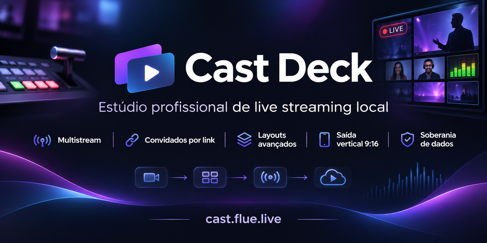

<div align="center">


# CastDeck Local

**Seu estúdio de live no seu computador — com a videochamada no centro.**

Uma alternativa ao StreamYard para quem quer convidados por link, cenas profissionais, gravação local e
multistream sem depender de uma assinatura na nuvem.

[](LICENSE)
[](#downloads)
[](package.json)
[](https://github.com/aloproducao2/castdeck-local/actions/workflows/ci.yml)
[](CONTRIBUTING.md)

[**Baixar**](https://cast.flue.live/downloads.html) ·
[**Alternativa ao StreamYard**](docs/streamyard-alternative.pt-BR.md) ·
[**Documentação**](docs/DOCUMENTACAO.md) ·
[**English**](README.md) · [**Apoie o projeto**](https://apoia.se/casdecklocal) · [**Español**](README.es.md)

<a href="https://www.producthunt.com/products/castdeck-local?embed=true&amp;utm_source=badge-featured&amp;utm_medium=badge&amp;utm_campaign=badge-castdeck-local" target="_blank" rel="noopener noreferrer"></a>

<a href="https://cast.flue.live"></a>

</div>


## Por que o CastDeck

O CastDeck nasceu de uma ideia simples: **a videochamada é o coração da live**, mas o estúdio não precisa
estar na nuvem. Você abre o CastDeck no seu PC, convida as pessoas por um link e opera tudo — câmeras,
áudio, cenas, GC, replay e transmissão — no mesmo lugar.

| | Estúdios na nuvem | **CastDeck Local** |
|---|---|---|
| Onde o vídeo é composto | servidor do fornecedor | **no seu computador** |
| Convidados | conta/app do serviço | **navegador, sem instalar** |
| Gravação | conforme o plano | **local, em MP4** |
| Saídas | plataformas do plano | **RTMP/RTMPS/SRT para onde quiser** |
| Vertical 9:16 | add-on/plano | **simultâneo e independente** |
| Custo | assinatura | **gratuito e aberto (AGPL-3.0)** |
| Código | fechado | **auditável e modificável** |

> StreamYard é uma marca de seus respectivos donos. Esta é uma comparação independente, sem afiliação.

## Videochamada em primeiro lugar

- **Convide por link.** O convidado entra pelo Chrome/Edge no celular ou PC, sem criar conta e sem instalar.
- **Mix-minus de verdade.** Cada pessoa ouve o programa sem ouvir a própria voz; o host conversa naturalmente.
- **O convidado vê o programa.** Ele acompanha a cena no ar, não só a própria câmera.
- **Host e convidados no palco**, com layouts de 1 a 4+ e troca por clique, prévia/PGM e mesa de corte com T-bar.
- **Compartilhamento de tela, aba e mídia** para entrevistas, aulas, podcasts e coberturas.
- **Modo vertical 9:16** com layout próprio e gravação separada, para TikTok/Reels/Shorts.

## No ar em 1 minuto

1. **Baixe e abra** o CastDeck (Windows, Linux, macOS ou Android).
2. Crie um estúdio e clique em **Convidar** — copie o link e envie.
3. Cadastre seus destinos (YouTube, Twitch, Facebook, RTMP/SRT) e clique em **Transmitir**.

Sem login, sem cartão e sem mensalidade. FFmpeg e cloudflared já vêm embutidos no executável.

## Recursos que fazem diferença

| 🎥 **Produção** | 🎙️ **Áudio** | 📺 **Entrega** |
|---|---|---|
| Cenas, layouts e transições | Mixer com faders e VU em dBFS | Multistream RTMP/RTMPS/SRT |
| Prévia e PGM independentes | Mix-minus e redução de ruído | Gravação MP4 local ilimitada |
| GC de telejornal e banners | Buses A–G e monitoramento | 16:9 e 9:16 ao mesmo tempo |
| Replay & VAR com IN/OUT | Música, mídia e jingles | Replay, stinger e câmera lenta |
| Overlays e galeria de imagens | Talkback e convidados | Controle remoto pelo celular |
| Legendas ao vivo (Whisper/Parakeet) | Áudio do sistema e convidados | Android como câmera/controle |

## Comparativo honesto

**StreamYard** é uma ótima escolha quando você quer uma sala na nuvem, com zero instalação e suporte do
fornecedor. O **CastDeck** é para quem quer outra coisa:

| Pergunta | StreamYard (SaaS) | CastDeck Local |
|---|---|---|
| Quero processar e gravar no meu PC | não | **sim** |
| Quero convidados sem conta/app | sim | **sim** |
| Quero multistream sem depender de plano | plano | **sim** |
| Quero código aberto e auditável | não | **sim** |
| Quero suporte oficial 24/7 | sim | **comunidade** |
| Quero abrir e usar sem instalar nada | sim | **app local (ou Android)** |

**Escolha o CastDeck se** privacidade, custo previsível, gravação local, vertical simultâneo e controle do
código importam. **Escolha o StreamYard se** você precisa de uma operação 100% gerenciada, suporte
contratual e não quer administrar um computador.

Leia o estudo completo: [**CastDeck como alternativa ao StreamYard**](docs/streamyard-alternative.pt-BR.md)
(também em [English](docs/streamyard-alternative.en.md) e [Español](docs/streamyard-alternative.es.md)).

## Downloads

| Sistema | Como obter |
|---|---|
| **Windows 10/11 x64** | [cast.flue.live/downloads.html](https://cast.flue.live/downloads.html) |
| **Android 8+** | APK oficial no site |
| **Linux x64/arm64** | binário/AppImage no site |
| **macOS Intel/Apple Silicon** | binário no site |

> macOS não assinado: na primeira abertura use **clique direito → Abrir**.
> Requisitos: Windows 10/11, Linux ou macOS; Chrome/Edge para a interface; 8 GB de RAM recomendados.

## Como funciona

```text
Navegador do host ──HTTP/WS──► Servidor local (Node) ──► FFmpeg ──► YouTube/Twitch/RTMP
        │                               │
        │ WebRTC                        ├─ convidados (navegador, mix-minus)
        ▼                               ├─ MediaMTX (RTMP/SRT de drones/câmeras)
   Canvas/Compositor ◄── cenas, GC, overlays, replay
```

- **Servidor local** Express/WebSocket em `127.0.0.1`/LAN.
- **WebRTC** para convidados, com TURN opcional para NAT difícil.
- **FFmpeg** para composição/gravação/RTMP; **MediaMTX** para ingestão.
- **Interface web sem framework**, servida pelo próprio app.

## Privacidade e segurança

O vídeo e o áudio do estúdio ficam no seu dispositivo. O app consulta o site apenas para verificar
atualizações; não envia o conteúdo da live para o CastDeck. Leia [`SECURITY.md`](SECURITY.md) e
[`PRIVACY.md`](PRIVACY.md). Para vulnerabilidades, use o canal privado — não abra issue pública.

## Apoie o projeto

O CastDeck é gratuito e independente. Se ele ajuda sua produção, você pode apoiar pelo
[Apoia.se](https://apoia.se/casdecklocal) — isso ajuda a cobrir servidores, aparelhos e tempo de desenvolvimento.

## Licença e comunidade

O CastDeck é **software livre sob AGPL-3.0-only**, com **licença comercial opcional** para quem precisa
incorporar o código em produto fechado. Componentes de terceiros mantêm suas licenças; consulte
[`THIRD-PARTY-NOTICES.md`](THIRD-PARTY-NOTICES.md) e [`licenses/`](licenses/).

- [`CONTRIBUTING.md`](CONTRIBUTING.md) — CLA e regras de contribuição
- [`CLA.md`](CLA.md) — acordo de contribuição
- [`TRADEMARK.md`](TRADEMARK.md) — uso da marca
- [`SOURCE-OFFER.md`](SOURCE-OFFER.md) — código-fonte correspondente
- [`COMMERCIAL-LICENSE.md`](COMMERCIAL-LICENSE.md) — licença comercial

## Status

Versão **1.4.3** — fonte Browser CEF no Windows com áudio, 4K, scroll, idioma da UI e adblock.
[releases](https://github.com/aloproducao2/castdeck-local/releases).

Feito por **Miguel Kallemback / flue.live**, de brasileiros para o mundo. 🌎
