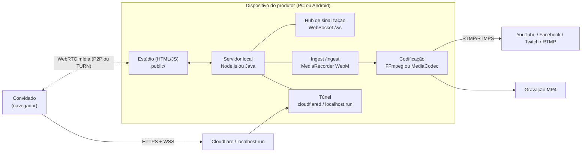
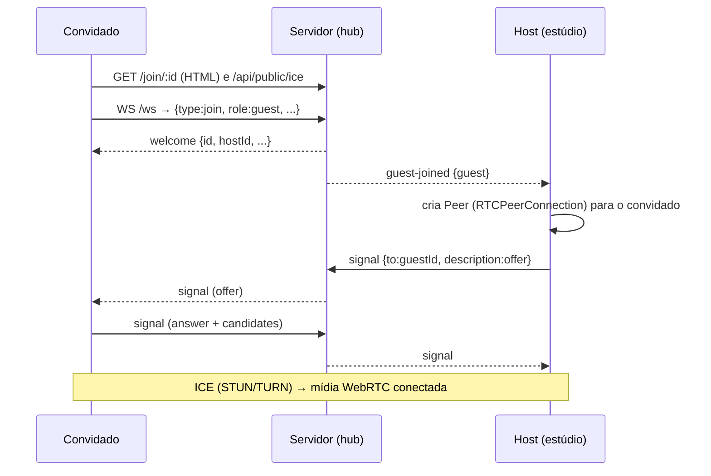

# CastDeck Local — Documentação Técnica e de Produto

> **Alternativa local, aberta e sem mensalidade aos estúdios de live na nuvem.**
> Estúdio de transmissão ao vivo que roda no seu próprio PC (Windows, Linux, macOS) ou celular/tablet Android:
> convidados remotos pelo navegador, cenas com sua marca, GC/jornal, gravação e restream simultâneo para várias plataformas.

| | |
| --- | --- |
| **Projeto** | CastDeck Local (`castdeck-local` v1.4.4, 2026-11-07) |
| **Licença** | AGPL-3.0 (código aberto) + licença comercial |
| **Autoria / desenvolvimento** | **Miguel Kallemback** (desenvolvedor e idealizador) |
| **Desenvolvimento assistido por IA** | Claude (Anthropic), Gemini / Antigravity (Google DeepMind) e DeepSeek |
| **Plataformas** | Windows 64-bit, Linux x64/arm64, macOS Intel/Apple Silicon, Android 8+ (ARM64) |
| **Pacote Android** | `com.castdeck.studio` |

---

## Sumário

1. [Visão e premissa](#1-visão-e-premissa)
2. [Comparativo com plataformas na nuvem](#2-comparativo-com-plataformas-na-nuvem)
3. [Funcionalidades](#3-funcionalidades)
4. [Intercom de produção (EGM)](#4-intercom-de-produção-egm)
5. [Arquitetura](#5-arquitetura)
6. [Fluxos principais](#6-fluxos-principais)
7. [Protocolo de sinalização](#7-protocolo-de-sinalização)
8. [Servidor e API HTTP](#8-servidor-e-api-http)
9. [Versão Android](#9-versão-android)
10. [Segurança](#10-segurança)
11. [Instalação e uso](#11-instalação-e-uso)
12. [Build e distribuição](#12-build-e-distribuição)
13. [Testes](#13-testes)
14. [Solução de problemas](#14-solução-de-problemas)
15. [Limitações conhecidas](#15-limitações-conhecidas)
16. [Roadmap sugerido](#16-roadmap-sugerido)
17. [Autoria e créditos](#17-autoria-e-créditos)

---

## 1. Visão e premissa

Plataformas de estúdio na nuvem entregam um estúdio no navegador: o apresentador chama convidados por link, monta cenas e transmite para YouTube, Facebook, Twitch etc. O custo é uma assinatura recorrente, com limites de resolução, destinos, gravação e marca d'água nos planos de entrada, e todo o vídeo passa pela infraestrutura de terceiros.

O **CastDeck Local** parte da premissa inversa:

- **O estúdio roda na máquina do produtor.** Mixagem, composição de cena e codificação acontecem localmente.
- **Sem conta, sem mensalidade, sem limite artificial** de destinos ou duração.
- **Dados e chaves de transmissão ficam no dispositivo** (`%LOCALAPPDATA%\CastDeck` no Windows).
- **O convidado só precisa de um link** e de um navegador moderno (Chrome/Edge), sem instalar nada.
- **Funciona no desktop e no celular**: o mesmo front-end roda no PC e dentro do APK Android.

### Princípios de projeto

| Princípio | Como se materializa |
| --- | --- |
| Local primeiro | Servidor embutido; nenhum backend em nuvem próprio |
| Zero configuração | FFmpeg e cloudflared embutidos nos executáveis; túnel automático |
| Mesma interface em todo lugar | A pasta `public/` é reaproveitada no PC e no APK |
| Resiliência | Reinício de ICE, reentrada do convidado, reconexão de destinos RTMP, backoff |
| Segurança por padrão | Painel/estúdio só respondem ao próprio dispositivo; tráfego do túnel é bloqueado nessas rotas |

---

## 2. Comparativo com plataformas na nuvem

> Comparativo conceitual de posicionamento. Planos, preços e limites dos serviços de terceiros mudam com frequência; confirme nos sites oficiais.

| Aspecto | Estúdios na nuvem | CastDeck Local |
| --- | --- | --- |
| Modelo | SaaS no navegador (assinatura) | Aplicativo local, código aberto (AGPL-3.0) |
| Onde o vídeo é processado | Nuvem do fornecedor | No seu PC/celular |
| Custo | Planos pagos para recursos avançados | Gratuito |
| Convidados | Link no navegador | Link no navegador (WebRTC + túnel Cloudflare) |
| Multistream | Plataformas suportadas pelo serviço | Qualquer destino **RTMP/RTMPS** (YouTube, Facebook, Twitch, personalizado) |
| Gravação | Conforme o plano | Local, ilimitada, MP4; horizontal e vertical simultâneas |
| Marca (logo, cores, overlay) | Conforme o plano | Incluída |
| GC / lower thirds / jornal | Banners | Banners, letreiro, notícias RSS e GC de telejornal |
| Saída vertical (Reels/TikTok/Shorts) | Limitada/variável | Segunda saída 9:16 simultânea e independente |
| Co-host | Sim | Sim, com permissões restritas e validação no servidor |
| Chat de redes | Integrado ao serviço | Via **Social Stream Ninja** |
| Dados e chaves | No serviço do fornecedor | Somente no dispositivo do produtor |
| Dependência de internet | Total | Internet para convidados/destinos; estúdio funciona local |

### Onde o CastDeck não substitui (ainda)

- Não oferece infraestrutura gerenciada: o **upload do produtor** limita o número de convidados (cada um recebe o programa de volta).
- Convidados atrás de CGNAT/NAT simétrico podem exigir um servidor **TURN**.
- Não há contas, equipes, agendamento de eventos ou hospedagem de replays na nuvem.

---

## 3. Funcionalidades

### Estúdio e produção
- **Backstage** com pré-visualização e controle de câmera/microfone de cada pessoa.
- **Palco** com arrastar para trocar posições, **modo Solo** e reordenação por chips.
- **Layouts**: 6 prontos (grade, solo, líder, lateral, PiP, dividido) e **editor de layouts personalizados** (arrastar, redimensionar, duplicar, distribuir, desfazer, ajuste fino em %).
- **Câmeras extras do host** (webcam USB/UVC, placa de captura) com áudio próprio.
- **Mesa de corte (modo OBS/vMix/ATEM)**: botão *Mesa de corte* na barra superior. Monitores de **PRÉVIA** (verde) e **PROGRAMA** (vermelho) lado a lado e do mesmo tamanho, com a coluna de transição no meio: **CORTE** seco, **AUTO** (dissolve de 0,3/0,5/1 s), **T-bar** arrastável para fazer o dissolve na mão (soltou no meio, termina sozinho; voltou ao início, nada vai ao ar) e **FTB** (fade to black, escurece o programa inteiro). O dissolve é **ao vivo**: as duas fontes continuam se mexendo durante a transição. Embaixo, a **barra de fontes** com miniaturas ao vivo (multiview): 0 = *Cena* (o palco com o layout atual), 1–9 = câmeras, telas e mídias em tela cheia; borda vermelha = no ar, verde = prévia, borda fraca = está dentro da Cena; botão *＋ Cena* em cada miniatura e card *＋ Câmera*. Atalhos: número = prévia, duplo clique ou Shift+número = corte direto, Espaço/Enter = corte, T = dissolve. Marca, GCs, letreiro e widgets continuam por cima durante a transição. O áudio não segue o corte: quem está no palco continua sendo ouvido e a fonte posta no ar soma o próprio áudio. Com a mesa ligada, os bastidores ficam ocultos (botão *Bastidores* mostra). Desligar a mesa volta ao modo Estúdio (estilo StreamYard).
- **Painel lateral recolhível** (desktop): o botão no topo do painel o transforma num trilho de ícones e libera espaço para os monitores. Clicar num ícone abre a seção flutuando por cima (Esc ou clique fora fecha; *Fixar* volta ao painel aberto). A escolha fica salva por modo: na mesa de corte o painel começa recolhido, no modo Estúdio começa aberto.
- **Tela cheia** (v1.3.26+): botão no canto de baixo do **PROGRAMA** e da **PRÉVIA** (aparece ao passar o mouse; no toque fica sempre visível) e *Tela cheia* na barra de fontes para a **mesa inteira** (PRÉVIA | transição | PROGRAMA + fontes maiores, como o multiview do vMix; atalhos continuam valendo). Atalhos: **F** = programa, **Shift+F** = mesa inteira; Esc sai. Parado por 2,5 s, nome e botão somem (monitor limpo; o tally fica discreto). No navegador usa a Fullscreen API; no app Android (e onde ela não existe) usa um "falso tela cheia" que cobre a janela e sai com o botão Voltar (`public/js/fullscreen.js`).
- **Câmera remota pelo celular** (＋ Câmera → *Celular ou outro aparelho*): dois QR Codes/links, **mesma rede** (`https://<ip-da-LAN>:3443/cam/:id`, melhor qualidade) e **internet** (link do túnel). A página `/cam/:id` usa a câmera traseira (720p ou 1080p, 30 ou 60 fps), microfone desligado por padrão, troca de câmera, lanterna, nome, tela sempre acesa e reconexão automática. **Tela cheia** (botão no topo) e um toque na imagem esconde os controles (o tally continua). Painel **Imagem**: zoom (também com pinça de dois dedos), foco automático/manual com distância, compensação de exposição, balanço de branco com temperatura, brilho/contraste/saturação/nitidez e lanterna — só aparece o que o aparelho libera (`getCapabilities`; Chrome no Android libera quase tudo, Safari no iPhone ainda não) e *Restaurar automático* reabre a câmera com os padrões. Painel **Aparelhos**: escolher a câmera (ultra-wide, tele, USB...) e o microfone, qualidade, fps e nome; fica salvo no aparelho. Toda troca usa `replaceTrack` no mesmo sender (sem renegociar; o host não muda nada). **Tally**: borda verde quando está na prévia e vermelha quando está no ar. O host não envia retorno nem mix-minus para essas câmeras (economiza CPU do PC e bateria/dados do celular).
- **Efeitos de vídeo por câmera** (botão ✦ no bloco da câmera): fundo virtual (desfocar, imagem da galeria ou enviada, cor sólida) e **enquadramento automático** que segue o rosto (Aberto/Médio/Fechado). Usa MediaPipe (Selfie Segmenter + BlazeFace) rodando localmente em GPU/WASM; só carrega quando um efeito é ligado, a segmentação é limitada a ~20 qps divididos entre as câmeras e o rosto é detectado 5x/s. Vale para host e convidados (processado no PC do estúdio).
- **Mesa de áudio estilo broadcast**: VU de programa L/R em dBFS (−60 a 0) com referência −18 dBFS (0 VU), pico retido, LED de CLIP e indicador do limitador; canais com fader 0–200% (campo em % e leitura em dB, duplo clique volta a 100%), mute e **redução de ruído por canal** (RNNoise em AudioWorklet, liga/desliga + intensidade). Ajustes do host ficam salvos.
- **Mídia local**: vídeos, áudios e imagens, com playlist, repetição e palco. Áudio AC3/DTS ou vídeo HEVC é convertido automaticamente via FFmpeg.
- **Compartilhamento de tela/aba** (desktop) para host e convidados.
- **Salvamento automático** do estado do estúdio.
- **Limpeza e armazenamento**: apaga gravações antigas, cache e mídias de outros estúdios.

### Gráficos e marca
- Banners com estilos, posições, cor, tempo no ar e alternância automática.
- **Camadas sobre o DSK:** em **GCs & Letreiro**, a chave **Overlays sobre o DSK** coloca comentários (destaque e feed), enquetes/QR/placar e banners **atrás do DSK** (padrão) ou **acima do DSK 1/2**. A opção é global, salva no estúdio e não altera letreiro/legendas, que continuam atrás do DSK.
- **Letreiro** com notícias **RSS/Atom** (feeds descobertos automaticamente), configurado na aba **Jornal**.
- **Jornal / GC**: lower thirds de telejornal (entrevistado/repórter e hard news) com logo opcional.
- **Widgets** (grupo Público → Enquetes e QR): enquetes votadas pelo chat (um voto por pessoa, barras ao vivo) e, opcionalmente, **pelo celular**: com “Votar pelo celular” ativo, a enquete exibe um QR Code no vídeo que abre uma página própria de votação (`/vote/:id`, um voto por aparelho por rodada; funciona fora da rede pelo túnel). Criadas/editadas numa janela própria, com duplicar e **tempo de votação** opcional (contagem "encerra em m:ss" no vídeo e encerramento automático); **QR Code** gerado localmente (cor, logo, título, posição).
- **Sports**: cadastro único de times (sigla, cor, escudo, técnico) com **elenco jogador a jogador** (número, nome, posição, ★ titular; colar lista ou editar como texto), placar no ar, cronômetro **progressivo ou regressivo** persistente, períodos/prorrogação configuráveis e 14 GCs de futebol (gol, cartões, substituição, VAR, confronto, placar etc.).
- **Partida**: jogadores escolhidos com um clique (em campo / banco), substituição "sai/entra" que atualiza a escalação, 2º amarelo vira expulsão automática, **lance a lance** com reexibir (▶) e desfazer (↶, inclusive tirando o gol do placar) e seção **Escalação** para ajustar quem está em campo.
- **Barra de controle**: GCs salvos e atalhos de futebol e mídia.
- **Menus do estúdio** agrupados em **Conteúdo** (Mídia, Banners, Jornal, Esportes), **Visual** (Marca, Exibição), **Interatividade** (Enquetes, Mensagens), **Público** (Chat, Redes), **Diretor** (AUTO-VOZ e controle remoto), **Áudio** (Mixer) e **Ajustes** (Transmissão, Dispositivos, Sinais). O painel pode ser recolhido em ícones (veja *Painel lateral recolhível*). Barra inferior: Mic, Câmera, Convidar | Mídia, Tela, Aba | Nomes, Cursor | Ajustes, Sair.
- **Destinos dentro da sala**: em Configurar → Transmissão (e na janela "Entrar ao vivo" e no painel vertical) dá para adicionar, editar, ativar/desativar e excluir destinos RTMP sem voltar ao painel.
- Variáveis `{mandante}`, `{visitante}`, `{placar}`, `{competicao}` e `{tempo}` em qualquer banner/GC.
- Marca: logo, cor, overlay e fundos. O fundo do palco aceita imagem, **GIF animado** (até 25 MB) ou vídeo mudo em loop, independente do Playout; o vídeo fica salvo para a próxima sessão.
- Aba **Redes** (Social Stream Ninja): cartão de destaque, feed rolante, filtros por plataforma.

### Salvamento
- Salvamento automático com indicador na barra superior (**Salvo / Salvando… / Não salvo — tentando de novo / Alterado em outra janela**), uma gravação por vez, novas tentativas automáticas e gravação imediata ao esconder/fechar a aba.
- Controle de revisão (`rev`): se outra janela salvou o mesmo estúdio, o servidor responde `409` e o app pergunta qual versão manter, em vez de sobrescrever.
- `db.json` gravado de forma atômica (temporário + `fsync` + rename com novas tentativas no Windows), backup `db.json.bak` a cada 5 min e recuperação automática; um arquivo corrompido é preservado como `db.json.corrupt-<data>`. O app Android segue as mesmas regras.

### Convidados e colaboração
- Entrada por link, sem instalação, com **lobby** (prévia de câmera/mic antes de entrar).
- **Mix-minus** por convidado (sem eco), com mixer.
- **Co-host**: painel de Produção (layout, palco, solo, banners, mute/pedido de microfone); não inicia live, não grava e não remove convidados.
- Indicador de qualidade (RTT, perda, bitrate) por convidado e adaptação de qualidade de envio.
- Chat entre participantes, com limite de taxa.

### Saída
- **Transmissão multi-destino** (RTMP/RTMPS), um processo FFmpeg por destino, com reconexão.
- Encoders: **x264 (CPU), NVENC, QSV, AMF, VideoToolbox** (detectados automaticamente).
- **Gravação** em MP4: só horizontal ou **horizontal + vertical**.
- **Modo Vertical (9:16)**: segunda saída 720×1280 ou 1080×1920, layouts próprios, zona segura, destinos e gravação independentes.
- **4K (2160p)**: presets 2160p30/2160p60 com bitrate próprio; gravação, transmissão, NDI e switching em 4K quando o hardware suportar.

### NDI (fonte e saída)

O NDI é opcional e fica **desligado por padrão** para economizar CPU, rede e memória. O botão **NDI** na barra superior fica **vermelho** quando inativo e **verde** quando ativo; um clique ativa/desativa o subsistema e abre o painel.

- **Saída NDI:** publica o programa horizontal como fonte NDI na rede local. É independente de transmissão, gravação e estúdio remoto. O áudio do programa também é publicado.
- **Entrada NDI:** lista as fontes visíveis na máquina/rede. Ao adicionar, a fonte entra nos bastidores e é publicada para o navegador por **SRT H.264 + Opus** e WHEP local, sem conversão intermediária.
- **Áudio:** a fonte NDI entra no Mixer com a tag **NDI** e usa o retorno de monitor; acompanha o palco/programa quando vai ao ar.
- **Reconexão:** entrada e saída tentam reconectar sozinhas após queda do bridge/FFmpeg. O subsistema permanece ativo; falhas aparecem no painel em vez de desligar o NDI.
- **Requisitos:** NDI Runtime 6.3+ (NDI Tools). O bridge é compilado em Rust e usa o runtime instalado; o app não redistribui o SDK. NDI® é marca registrada da Vizrt NDI AB.

### Browser (fonte web)

- No Windows usa o **BrowserHost CEF** local (shared texture + áudio); nos demais sistemas cai para o Edge headless.
- Segue o preset da mesa: 720p30/60, 1080p30/60 e 4K30/60 quando configurado.
- Áudio da página entra no Mixer como canal BROWSER.
- **Interagir**: prévia ampliada com clique, texto, scroll, troca de URL e recarregar.
- **PGM** usa uma única superfície de fontes: miniaturas agrupadas, prévia por clique e corte por duplo clique.
- Miniaturas podem ser agrupadas por tipo (modo opcional) e mídias aparecem em lista.
- Idioma do navegador segue o idioma da interface (pt-BR/en-US/es-ES).
- Adblock básico ativado por padrão, com botão ON/OFF.
- Lixeira na miniatura e menu de ações com botão direito.
- Limite de 2 fontes em 720p/1080p ou 1 em 4K.

### Replay & VAR (desktop)

O módulo abre em uma **janela dedicada** (`/replay.html`) e é exclusivo do desktop (Windows, Linux e macOS; não existe no app Android).
Ele só liga quando o console é aberto: fechado, não consome encoder nem memória de buffer.

- **Buffer circular em RAM**: captura o PGM (ou uma fonte escolhida) em WebM/VP8 via `MediaRecorder`, em pedaços de 1 s, com keyframe de 1 s. A janela padrão é 45 s e pode ir de 10 a 180 s.
- **Corte instantâneo**: `-5s`, `-10s`, `-15s`, `-30s` começam sempre em um **Cluster/keyframe real** e reescrevem os timecodes para o clipe começar em 0 s.
- **IN/OUT ao vivo**: com o Preview no ao vivo, `I` marca o IN; `O` recorta de IN−1,5 s até o OUT, salva o lance na lista **sem sair do ao vivo** e mantém a marcação para o próximo lance.
- **Playout**: Preview com play/pause, passo de quadro, scrub, velocidades 25/50/75/100% e seleção do ângulo ativo; o TAKE envia o preview ao PGM.
- **Stinger e VAR**: transição de entrada/retorno no **PGM**, linhas, carimbo de decisão (GOL/IMPEDIMENTO/PÊNALTI etc.) e zoom/lupa local.
- **ISO 4 CAM**: quatro buffers independentes de 30 s, congelados no mesmo instante de parede, com play/pause/seek/passo sincronizados; o ângulo ativo vai ao PGM. Usa quatro encoders — recomendado em desktop com folga de CPU.
- **Playlist**: renomear (persistido), reordenar, baixar um lance, tocar todos e excluir.
- **Áudio**: **mudo por padrão** (padrão de replay/VAR); o operador pode escolher CUE (só fone), PGM, ambos ou mudo na rack. Quando liberado, o áudio do clipe entra no `programTrack` pelo mixer.

### Controladores USB e MIDI (desktop)

| Entrada | Como conecta | Observações |
| --- | --- | --- |
| **MIDI** | Web MIDI (Chrome/Edge) | Notas e CC; fader absoluto para velocidade, CC relativo para jog |
| **Gamepad/joystick USB** | Gamepad API | Botões e eixos; preset genérico |
| **HID genérico** | WebHID (Shuttle, X-Keys, Stream Deck em modo HID) | Botão vira "press"; roda/byte variável vira jog (delta) |

O painel **CTRL** tem **Aprender**, presets (MIDI genérico, nanoKONTROL2, gamepad), remoção de binding e persistência em `localStorage`. Ações: play/pause, passo ±1 quadro, jog, fader, 10/25/50/75/100%, TAKE, TAKE com stinger, voltar ao vivo, IN/OUT, salvar lance, mirror, VAR, 1/4 câmeras, replay 5/10/15/30 s e CAM 1–4.

### Overlays (DSK 1 e 2)

Duas camadas fixas acima de tudo (GC, letreiro, logo), independentes da cena e do corte — iguais no modo Estúdio, na mesa de corte, na prévia e no retorno do convidado. Cada uma aceita **endereço web**, **fonte do CastDeck** ou uma **galeria de imagens**.

- **Galeria de imagens:** envie PNG, JPEG, WebP ou GIF (até 25 MB cada, até 60 por DSK), clique na miniatura para colocar no ar e troque na hora pelo botão **🖼** do deck (Shift+clique volta) ou pelas setas da janela. O modo **Trocar automaticamente** alterna a cada 3–30 s enquanto a camada está no ar.
- **Sem navegador para imagens:** a imagem é decodificada uma vez no estúdio e desenhada direto no canvas do programa; não abre Edge/Chrome, não gera screencast e não consome encoder.
- **Armazenamento:** os arquivos ficam em `DATA/dsk-assets/` e são servidos por `/api/dsk/assets/<arquivo>`; o JSON do estúdio guarda só `{id, name, url}`.
- **Página web:** renderizada no Edge/Chrome sem janela, com fundo transparente (PNG) ou **página opaca** (JPEG). Captura em **15/20/30/60 qps**, **qualidade JPEG 60–95%** e **deduplicação de quadros** (bitmap repetido não é reenviado).
- **Recuperação do navegador:** se o perfil do Edge/Chrome estiver preso ou corrompido, o servidor tenta novamente, usa um perfil reserva e, por fim, um perfil temporário; o primeiro quadro de uma página parada é sempre entregue e a mensagem de erro inclui o motivo do fechamento.
- **Aparência:** mesclagem (normal, screen, adição, multiplicação, overlay, luz suave, luma e chroma), opacidade, fade de 0–5 s, posição/corte próprios e configuração separada para a saída vertical 9:16.
- **Interação:** na página web, o botão **Interagir** envia mouse/teclado do estúdio para a página (login, cookies, escolher sala). Imagens não precisam disso.

---

## 4. Intercom de produção (EGM)

> **Disponível na 1.3.36** no estúdio, na página `/cam` e na página independente `/intercom/:id`.
> Guia completo: [`docs/INTERCOM.md`](https://github.com/aloproducao2/castdeck-local/blob/main/docs/INTERCOM.md)
> e página do site [`intercom.html`](https://cast.flue.live/intercom.html).

O intercom é a via de áudio de produção entre o diretor e a equipe. Ele não é uma chamada de vídeo
e não vai ao programa por padrão:

```text
DIRETOR  ── fala/ouve ──  CÂMERA 1
         ── fala/ouve ──  CÂMERA 2
         ── fala/ouve ──  REPÓRTER
         ── envia ──────  PROGRAMA (IFB)
```

### 4.1 Papéis

| Papel | Onde entra | Ouve | Fala |
|---|---|---|---|
| **Diretor / host** | Estúdio → Áudio → Intercom | câmeras, repórteres e programa | todos, grupos ou pessoa |
| **Cinegrafista** | `/cam` | diretor e, opcionalmente, programa | diretor |
| **Repórter** | `/intercom/:id` | diretor e, opcionalmente, programa | diretor |
| **Convidado comum** | link de convidado | retorno do programa | programa |

### 4.2 EGM — seis lentes

#### Operação

- PTT geral, por grupo e individual.
- Teclas **TODOS**, **CÂMERAS**, **REPORTAGEM** e **PGM**.
- **Mic Unlatch** e **Silenciar todos**.
- **Microfone da direção** e **saída do retorno** escolhidos no próprio painel do intercom.
- Troca de dispositivo ao vivo, sem sair da sala.
- Mini painel opcional com PTT e corte de câmeras juntos.

#### Criação

1. Abrir **Áudio → Intercom**.
2. Clicar em **Link/QR**.
3. Escolher link da mesma rede ou Internet.
4. Enviar para o celular da equipe.
5. Usar fone e liberar o microfone.

#### Automação

- PTT com rampa curta, sem clique.
- Retorno pessoal sem a própria voz.
- Mesmo peer WebRTC da câmera.
- Mini painel atualiza quando alguém entra ou sai.
- IFB do programa em volume separado.
- O microfone nunca abre sozinho.

#### Cognição

| Estado | Sinal visual |
|---|---|
| Conectado | ponto verde |
| Ouvindo | botão “Ouvindo” |
| Falando | PTT azul/ciano |
| Travado | **MIC TRAVADO** em âmbar |
| PGM / PVW | tally vermelho / verde |
| Sem participantes | **SEM PARTICIPANTES** |
| Tela ativa | indicador na página mobile |

Vermelho e verde são reservados ao tally. O intercom usa azul/ciano para falar e âmbar para
travar ou chamar atenção.

#### Performance

- Áudio mono, sem vídeo no canal de repórter.
- Mesmo peer da câmera: o vídeo não é interrompido.
- Um destino WebAudio por participante.
- Áudio de intercom separado do encoder RTMP.
- A latência depende da rede, do túnel e do TURN.

#### Confiança

- Intercom fora do programa por padrão.
- PTT travado com **Mic Unlatch**.
- Link independente com chave do estúdio.
- Host somente no PC local.
- Nenhum áudio de intercom é gravado.
- Fone é obrigatório para evitar eco.

### 4.3 Fluxo do host


```text
Áudio → Intercom
  ├─ PTT GERAL ................ fala com todos
  ├─ TODOS .................... tecla de grupo
  ├─ CÂMERAS .................. fala/ouve cinegrafistas
  ├─ REPORTAGEM ............... fala/ouve repórteres
  ├─ PGM ...................... só escuta o programa
  ├─ Participantes ............ PTT e escuta por pessoa
  ├─ Travar PTT ............... microfone aberto até fechar
  ├─ IFB ...................... programa no retorno
  ├─ Link/QR .................. convite local/Internet
  └─ Mini ..................... painel flutuante + corte
```

### 4.4 PTT momentâneo e travado

| Modo | Ação | Uso |
|---|---|---|
| **Momentâneo** | segure para falar | operação normal |
| **Travado** | ative **Travar PTT** e clique no PTT | mãos ocupadas / direção contínua |

No modo travado:

- um clique abre o microfone;
- outro clique fecha;
- o botão fica em âmbar;
- **Mic Unlatch** fecha imediatamente.

### 4.5 Página da câmera (`/cam`)

- Faixa de intercom com PTT grande.
- **Travar** mantém o microfone aberto.
- **Ouvindo** controla o retorno do diretor.
- O microfone começa desligado.
- O vídeo continua no mesmo peer.
- O tally continua vermelho no ar e verde na prévia.


### 4.6 Página independente (`/intercom/:id`)

Para repórter ou cinegrafista que só precisa de áudio:

- PTT grande;
- escuta do diretor;
- volume;
- **Travar PTT**;
- indicador **Tela ativa**;
- notificação de mídia do Chrome;
- reconexão ao voltar.

Link:

```text
https://<servidor>/intercom/<id-do-estúdio>?k=<chave>&role=reporter
```


### 4.7 Mini painel Intercom + Corte

O mini painel é opcional:

- abre pelo ícone de microfone da barra superior ou pelo botão **Mini**;
- fica flutuante e arrastável;
- compartilha o PTT e o travamento com o painel principal;
- mostra **CORTE RÁPIDO** com as câmeras;
- clicar numa câmera corta a fonte para o programa;
- o botão **Painel** abre a lateral do Intercom;
- a posição fica salva no navegador.


### 4.8 IFB do programa

O IFB leva o programa ao fone de quem está na rua ou atrás da câmera:

- volume do programa independente do volume da voz do diretor;
- o participante não ouve a própria voz;
- o programa não entra no programa;
- use fone para evitar realimentação.

### 4.9 Celular e tela desligada

A página mobile usa:

- **Screen Wake Lock** para manter a tela ativa;
- **Media Session** com o título “Intercom — CastDeck”;
- **áudio de manutenção silencioso**;
- reconexão ao voltar para a aba.

Isso é o máximo que uma página web consegue fazer. O Android ainda pode suspender a aba quando o
aparelho é bloqueado. Para background garantido seria necessário um serviço em primeiro plano no
aplicativo Android nativo.

### 4.10 Segurança

- O link de intercom exige `k=<chave>`.
- A chave é a mesma do link de saída nesta versão.
- O host só abre no PC local.
- O intercom não entra no programa por padrão.
- Use **Silenciar todos** em emergência.
- Não compartilhe o link fora da equipe.

### 4.11 Diagnóstico rápido

| Sintoma | O que fazer |
|---|---|
| Link não abre | gerar novo Link/QR no host |
| Chave inválida | gerar novo link |
| Não ouço | tocar em Ouvir e liberar o áudio no navegador |
| Não falo | liberar microfone; segurar o PTT ou ativar Travar |
| Eco | usar fone |
| Mini PTT sem reação | conectar um participante; ver **SEM PARTICIPANTES** |
| Painel não abre pelo mini | atualizar para 1.3.33; o botão abre a lateral |
| Tela apaga | manter ativa; background web é melhor esforço |

### 4.12 Limites desta versão

- Sem sidetone ajustável.
- Sem call/cue sem voz.
- Sem ducking automático do IFB.
- Grupos fixos.
- Sem chave separada da chave de saída.
- Sem gravação de intercom.
- Teste em aparelhos reais ainda recomendado.

### 4.13 Critérios de aceite

- [ ] Host fala com todos, grupo e pessoa.
- [ ] Câmera ouve o diretor e fala de volta.
- [ ] Repórter entra pelo link com chave.
- [ ] PTT travado abre/fecha com um clique.
- [ ] Mic Unlatch funciona.
- [ ] Intercom não vai ao programa por padrão.
- [ ] IFB tem volume próprio.
- [ ] Câmera não perde vídeo ao usar intercom.
- [ ] Mini painel abre, arrasta e corta câmera.
- [ ] Mini PTT atualiza quando alguém entra/sai.
- [ ] Página mobile mostra “Tela ativa”.
- [ ] Link sem chave é recusado.
- [ ] Funciona em LAN e Internet.

---

### 4.14 Versão pública — CastDeck Intercom

Além do intercom local do estúdio, existe uma versão pública de salas:

- **URL:** https://cast.flue.live/intercom/
- **Sem login.**
- **Só áudio de produção.**
- Salas **permanentes** com ID aleatório ou digitado; os links podem ser reutilizados.
- Nome definido pelo host; se ficar vazio, é gerado automaticamente.
- Salas recentes ficam salvas no navegador do host, com atalho para reabrir.
- Interface em **português, inglês e espanhol** (seletor no topo).
- Senha opcional.
- Host e convidado com links separados.
- Até 1 host + 14 convidados (15 pessoas no total).
- PTT geral, PTT individual e PTT travado.
- Escolha de microfone e saída de áudio na hora, quando o navegador permite.
- Instalável como PWA (Android/desktop).
- Wake Lock opcional, Media Session e áudio em segundo plano quando o Android permite.
- Host pode mutar, remover e **encerrar a sessão**. A sala e os links permanecem.
- Salas persistem em arquivo protegido no servidor e sobrevivem a restart. Sessões ao vivo caem.
- TURN público em `turn.flue.live`.
- Não é vídeo, chat, gravação ou IFB.

A página de marketing continua em https://cast.flue.live/intercom.html.
O código e o plano EGM ficam em `intercom-rooms/`.

Diferença de escopo:

| | Intercom local 1.3.33 | CastDeck Intercom público |
|---|---|---|
| Onde vive | estúdio local | site |
| Quem entra | equipe do estúdio | qualquer pessoa com o link |
| Salas | uma por estúdio | várias salas permanentes |
| IFB do programa | sim | não |
| Vídeo | não | não |
| Login | não | não |
| Gravação | não | não |


---

## 5. Arquitetura



### Camadas

| Camada | Tecnologia |
| --- | --- |
| Interface | HTML + JavaScript puro (módulos ES) + CSS próprio; sem framework |
| Servidor (PC) | Node.js ≥ 20, Express 5, `ws`, `selfsigned` |
| Servidor (Android) | Java, NanoHTTPD + NanoWSD (porta fiel do servidor Node) |
| Convidados | WebRTC em topologia **estrela** (host ↔ cada convidado) |
| Sinalização | WebSocket JSON (`/ws`) |
| Acesso pela internet | Cloudflare *quick tunnel* (padrão) e localhost.run via SSH (reserva) |
| Mixagem de áudio | Web Audio API (mix-minus por convidado) |
| Composição de cena | Canvas 2D |
| Replay/VAR (desktop) | `MediaRecorder` WebM + ring buffer em RAM, recorte por Cluster e playout em `<video>`; ISO com 4 buffers |
| Controladores | Web MIDI, Gamepad API e WebHID no console de Replay |
| Overlays (DSK) | Imagens desenhadas direto no canvas; páginas web via screencast CDP em PNG/JPEG |
| Captura para saída | `MediaRecorder` → WebSocket `/ingest` |
| Codificação PC | FFmpeg (x264/NVENC/QSV/AMF/VideoToolbox) |
| Codificação Android | MediaCodec H.264 + AAC por hardware, `RtmpPublisher` próprio, `MediaMuxer` para MP4 |
| Empacotamento PC | esbuild + `@yao-pkg/pkg`; lançador desktop em Rust/Tauri (`src-tauri/`) |
| Empacotamento Android | Gradle (`android/`) |

### Topologia de mídia

O host é o centro. Cada convidado envia câmera/microfone ao host e **recebe de volta o programa** já composto (com mix-minus). A composição e a codificação ocorrem uma única vez, no host.

---

## 6. Fluxos principais

### 6.1 Entrada de um convidado



### 6.2 Transmissão

1. O estúdio compõe a cena em um `canvas` e mixa o áudio no Web Audio.
2. `MediaRecorder` gera WebM e envia pelo WebSocket `/ingest` (somente local).
3. O servidor lança **um processo FFmpeg por destino** (PC) ou usa `Broadcast.java` (Android) para codificar em H.264/AAC e publicar em RTMP/RTMPS.
4. Falhas de destino disparam reconexão sem derrubar os demais.

### 6.3 Recuperação de conexão do convidado

- `Peer.recover()` reinicia o ICE em quedas; após falhas repetidas dispara o evento `stuck`.
- O convidado reentra na sala (`forceRejoin`) com **backoff exponencial** (2 s → 4 s → … até 30 s) e **para após 4 tentativas**, exibindo a causa em vez de entrar em loop.
- O host refaz a conexão no máximo 3 vezes seguidas e depois apenas avisa; o contador zera quando alguém conecta.

---

## 7. Protocolo de sinalização

WebSocket em `/ws`, mensagens JSON. O hub (`server/signaling.js`, e `SignalingHub.java` no Android) mantém salas em estrela.

### Cliente → servidor

| `type` | Quem envia | Função |
| --- | --- | --- |
| `join` | host e convidado | Entra na sala `{room, role, name, state, key}`; `role:"host"` só é aceito se local |
| `signal` | ambos | Repassa SDP/ICE `{to, data}` (somente host ↔ convidado) |
| `chat` | ambos | Mensagem de chat (máx. 500 caracteres, 6 por 4 s) |
| `state` | ambos | Estado público (`name`, `camOn`, `micOn`, `camStreamId`, `screenStreamId`) |
| `control` | host | `mute`, `unmute-request`, `kick`, `reconnect`, `stage`… para um convidado |
| `studio-state` | host | Estado da live (ao vivo, gravando, no palco) para todos |
| `set-cohost` | host | Promove/rebaixa um convidado a co-host |
| `cohost-state` | host | Estado enviado aos co-hosts |
| `cohost-cmd` | co-host | Comando de produção, **validado/sanitizado** (`cleanCmd`), 20/s |
| `ping` | ambos | Keep-alive (a cada 20 s no cliente) |

### Servidor → cliente

`welcome`, `guest-joined`, `guest-left`, `guest-state`, `host-online`, `host-offline`, `signal`, `chat`, `control`, `studio-state`, `role`, `cohost-state`, `cohost-cmd`, `error`.

### Códigos de fechamento

| Código | Significado | Reconecta? |
| --- | --- | --- |
| 4001 | Removido pelo host (kick) | Não |
| 4002 | Substituído (host aberto em outra janela) | Não |
| 4003 | Host só pode ser local | Não |
| 4004 | Estúdio inexistente | Não |
| outros | Queda de rede etc. | Sim, com atraso |

O servidor envia *ping* a cada 15 s e encerra clientes que não respondem.

---

## 8. Servidor e API HTTP

Porta padrão **3000** (HTTP, local) e **3443** (HTTPS com certificado autoassinado para a LAN).

### Páginas

| Rota | Acesso |
| --- | --- |
| `/` | Painel — **somente local** |
| `/studio/:id` | Estúdio — **somente local** |
| `/replay.html` | Console de Replay & VAR — **somente local**, desktop |
| `/join/:id` | Página do convidado — pública (via túnel) |
| `/cam/:id` | Câmera remota (celular pelo QR Code) — pública (via túnel ou LAN) |

### API pública (usada pelos convidados)

| Rota | Descrição |
| --- | --- |
| `GET /api/public/studios/:id` | Nome e cor do estúdio |
| `GET /api/public/ice` | Servidores ICE (STUN + TURN configurado ou *fallback* público) |
| `GET /vote/:id` | Página de votação da enquete (aberta pelo QR Code) |
| `GET /api/public/vote/:id` | Enquete ativa do estúdio (pergunta, opções, rodada) |
| `POST /api/public/vote/:id` | Registra o voto do celular (um por aparelho por rodada) |

### API administrativa (`/api/...`, **somente local**)

Inclui, entre outras: `/system`, `/tunnel` (+ `/start`, `/restart`, `/stop`), configurações, estúdios, destinos de transmissão, gravações, pasta de gravações, limpeza e proxy de imagens (`/api/img-proxy`). O Replay usa `/api/replay/clips` (listar/renomear/excluir), `/api/replay/config` (buffer e cota), `/api/replay/save`, `/api/replay/file/:name` (Range/HTTP 206) e `/api/replay/match/*`. Os overlays usam `PUT /dsk/:key`, `POST /api/dsk/assets?name=...`, `GET/DELETE /api/dsk/assets/:file` e `/dsk` via WebSocket. A lista completa está em `server/index.js` (PC) e `LocalServer.java` (Android).

### Servidores ICE

`/api/public/ice` devolve:

1. STUN: `stun.cloudflare.com`, `stun.l.google.com`, `stun1.l.google.com`.
2. **TURN do usuário** (Painel → Conexão), se configurado.
3. Sem TURN próprio: **TURN oficial do CastDeck** (`turn.flue.live`, UDP/TCP 3478 e TLS 5349). O app busca credenciais temporárias (6 h) em `https://cast.flue.live/api/turn` e as renova sozinho; o relay tem limite de banda por sessão e bloqueia redes internas.
4. Reserva: relays públicos gratuitos da *Open Relay* (Metered), como **melhor esforço**.

---

## 9. Versão Android

O estúdio completo roda no celular ou tablet. O servidor Node foi **portado para Java** e roda em um serviço em primeiro plano.

| PC (Node) | Android (Java) |
| --- | --- |
| `server/index.js` | `LocalServer.java` (NanoHTTPD) |
| `signaling.js`, `store.js` | `SignalingHub.java`, `Store.java` (mesmo protocolo e `db.json`) |
| FFmpeg (`broadcast.js`) | `Broadcast.java`: WebM → `WebmDemuxer` → MediaCodec (H.264+AAC) → `RtmpPublisher` + MP4 |
| `certs.js` | `SelfSignedCert.java` |
| `tunnel.js` | `AndroidTunnel.java`: `cloudflared` embutido (`libcloudflared.so`) + localhost.run via SSH (JSch) |

### Comportamento específico

- **Segundo plano:** `ServerService` é um serviço em primeiro plano com tipos `specialUse`, `camera` e `microphone` (Android 14+), mantendo servidor, convidados e transmissão vivos. O `WebView` é mantido ativo e com prioridade alta para não congelar câmera e composição.
- **Layouts:** retrato (preview em largura total, barras roláveis, painel em gaveta), paisagem (preview grande + funções à direita) e Samsung DeX/janela livre.
- **Recursos ocultos no celular:** Tela, Aba e Cursor (o WebView não captura tela).
- **Gravações:** `Filmes/CastDeck` (visíveis na Galeria).
- **Notificação** "CastDeck está ativo" com ação **Encerrar**.

### Particularidade importante: handshake do WebSocket

O NanoHTTPD responde ao handshake WebSocket com `Content-Length: 0` em um `101 Switching Protocols`. O túnel da Cloudflare **cancela** o stream por causa disso (`stream error: CANCEL` no log do cloudflared), derrubando o convidado imediatamente após o `join`. `LocalServer.Http.withoutContentLength` remove esse cabeçalho do 101 em `/ws` e `/ingest`.

### Diagnóstico no Android

Tags de `logcat`:

| Tag | Conteúdo |
| --- | --- |
| `CastDeck.Server` | Fechamento de WebSocket (código, quem fechou) e exceções |
| `CastDeck.Tunnel` | Provedor, URL pública e saída do cloudflared |
| `CastDeck.Signal` | Erros do hub de sinalização |

Depuração do WebView: `adb forward tcp:9222 localabstract:webview_devtools_remote_<pid>` e Chrome DevTools Protocol.

---

## 10. Segurança

| Risco | Mitigação |
| --- | --- |
| Acesso remoto ao painel/estúdio via túnel | `isLocalReq`: exige origem loopback, **ausência** de cabeçalhos `cf-*`/`x-forwarded-*` e `Host` local; tráfego do túnel recebe 403 |
| DNS rebinding contra o painel | Validação do cabeçalho `Host` |
| Convidado tentando assumir o papel de host | `role:"host"` recusado se a conexão não for local (4003) |
| Abuso de chat/comandos | Limite de taxa (chat 6/4 s; co-host 20/s) |
| Dados de estado arbitrários | `cleanState` aceita apenas campos conhecidos e tamanhos limitados |
| Comandos de co-host | Sanitizados no servidor (`cleanCmd`) e revalidados no host |
| Convidado lento travando o servidor | Envio assíncrono por conexão (Android) / `terminate` em timeout |
| Chaves de transmissão | Armazenadas apenas no dispositivo; rotas administrativas só locais |
| Certificado HTTPS na LAN | Autoassinado (aviso do navegador é esperado) |

> **Atenção:** o link público do túnel dá acesso à sala a quem o tiver. Compartilhe apenas com convidados. O APK é assinado com chave de depuração; para publicar, use chave própria.

---

## 11. Instalação e uso

### Usuário final (PC)

1. Execute `CastDeck.exe` (portátil) ou o **instalador** `CastDeck-Setup-1.4.4.exe` no Windows — FFmpeg e cloudflared já vêm embutidos. O instalador cria atalhos, início automático opcional e desinstalador, sem apagar `%LOCALAPPDATA%\CastDeck`.
2. Crie um estúdio no painel.
3. **Convidar** → copie o link `https://….trycloudflare.com/join/…` e envie.
4. Cadastre destinos (YouTube, Facebook, Twitch, RTMP) e clique em **Transmitir**.

Dados em `%LOCALAPPDATA%\CastDeck`; gravações em `Vídeos\CastDeck`; log em `%LOCALAPPDATA%\CastDeck\logs\castdeck.log`.

### Linux / macOS

`dist/CastDeck-linux-x64|arm64` (`chmod +x`) e `dist/CastDeck-macos-x64|arm64`. No macOS não assinado: clique direito → Abrir, ou `xattr -d com.apple.quarantine CastDeck-macos-*`.

### Android

Instale `dist/CastDeck.apk` (permita apps desconhecidos). Conceda câmera, microfone e notificações. Para rodar em segundo plano com estabilidade, desative a otimização de bateria para o app.

### Configuração de rede (Painel → Conexão)

| Opção | Uso |
| --- | --- |
| Provedor de túnel | Cloudflare (padrão), localhost.run (SSH) ou automático com troca |
| TURN | URLs, usuário e credencial — **recomendado** para convidados em 4G/CGNAT |
| Link fixo | Túnel nomeado da Cloudflare (conta própria) |

---

## 12. Build e distribuição

```bash
npm install
npm start                 # http://localhost:3000
npm run build:exe         # dist/CastDeck.exe (esbuild + pkg), só o seu sistema
npm run build:all         # todos os sistemas (baixa FFmpeg/cloudflared em build/vendor)
npm run build:android     # dist/CastDeck.apk (Android Studio/SDK + JDK do Android Studio)
npm run build:appimage    # dist/CastDeck-x86_64.AppImage e -aarch64 (via WSL, depois do build:all)
npm run release -- --notes "novidade 1;novidade 2"   # versão nova + todos os builds + publicação no site
```

- Lançador Windows compilado com o `csc.exe` do Windows; ícone/splash gerados por `build/make-assets.ps1`.
- O APK embute `public/` e o `cloudflared` linux-arm64 (`libcloudflared.so`).
- Dependências do Android relevantes: NanoHTTPD (`nanohttpd-websocket 2.3.1`), JSch.

### Versão única

- O `version` do `package.json` é a **única fonte**. Ele vai para:
  - os executáveis (`__APP_VERSION__` no servidor e versão de arquivo do lançador Windows);
  - o APK (`versionName`; `versionCode` = `maior*10000 + menor*100 + patch`);
  - os AppImages;
  - a release publicada na landing page.
- A versão aparece no boot (`CastDeck Local vX.Y.Z pronto`), em **Painel → Sistema** e em `GET /api/system` (`version`).
- Comandos:
  - `npm run version:show` mostra a versão atual.
  - `npm run version:next` avança para a próxima versão ainda não publicada (aceita `minor` ou `major` como argumento).
- Cada build registra em `dist/build-info.json` com qual versão o arquivo foi gerado. O `landpage:publish` recusa binários de outra versão e versões já publicadas.

### Atualizações automáticas (v1.3.26+)

- **Fonte:** `https://cast.flue.live/releases.json` (gerado pelo `npm run release`, com `size` e `sha256` de cada artefato). A plataforma de cada instalação vem de `updateTarget` em `/api/system` (`windows-x64`, `linux-x64[-appimage]`, `macos-arm64`, `android-arm64`…).
- **Verificação** (`public/js/updates.js`): ao abrir o painel e a cada 6 h (`localStorage cd-upd-auto`), ou manual em Painel → Sistema. Banner no topo com notas; "Depois" pula aquela versão (`cd-upd-skip`).
- **Instalação dentro do app** — rotas locais: `GET /api/update/status`, `POST /api/update/download`, `POST /api/update/install` (recusa com 409 se houver transmissão/gravação).
  - O servidor busca o `releases.json`, baixa por `/dl/<ver>/<arquivo>` (conta no contador do site), confere o SHA-256 e guarda em `<dados>/update/`.
  - **Windows** (`server/updater.js`): o lançador passa `CASTDECK_EXE`; um `.cmd` oculto (caminhos via variáveis de ambiente, para aceitar acentos) espera o `CastDeck.exe` liberar, faz `move /y` e reabre. O servidor encerra com código 0 e o lançador fecha a janela.
  - **Linux**: substitui `APPIMAGE`/`process.execPath` por rename atômico e reabre via `sh -c "sleep 3; exec"` com `NO_OPEN=1`; a janela aberta recarrega sozinha quando o servidor volta.
  - **macOS**: sem troca automática (binário não assinado) → abre o download no navegador.
  - **Android** (`Updater.java` + `UpdateProvider.java`): baixa o APK para `cache/update`, confere o SHA-256 e abre o instalador por `content://com.castdeck.studio.update/…` (`REQUEST_INSTALL_PACKAGES`; se faltar a permissão de fontes desconhecidas, abre essa tela antes).
- **Atenção:** o Android só aceita a atualização se o APK novo for assinado com a **mesma chave** do instalado. Hoje é a chave de depuração deste PC — guarde-a ou migre para uma chave própria antes de distribuir em larga escala.

---

## 13. Testes

Com o CastDeck em execução:

| Comando | Cobertura |
| --- | --- |
| `npm run test:record` | Ingest sintético → MP4 gravado |
| `npm run test:rtmp` | Restream para servidor RTMP local e validação H.264/AAC |
| `npm run test:ui` | E2E de navegador (host + convidado, mídia, WebRTC); exige Edge com `--remote-debugging-port=9333` |
| `npm run test:switcher` | Câmera remota (`/cam/:id`) + mesa de corte: monitores lado a lado, painel em ícones, corte, dissolve, T-bar (mouse real), FTB, tela cheia (programa, prévia, mesa), painéis de ajuste da câmera, tally, atalho e volta à Cena |

A pasta `test/` contém ainda roteiros E2E de layout, co-host, vertical, notícias, jornal, arrastar, túnel (`tunnel-guest.mjs`) e Android (`android-e2e.mjs`).

---

## 14. Solução de problemas

| Sintoma | Causa provável | Ação |
| --- | --- | --- |
| Convidado **entra e sai** pelo link Cloudflare (Android, versão antiga) | `101` do NanoHTTPD com `Content-Length: 0` cancelado pelo túnel | Atualize o APK (corrigido em `LocalServer.Http`) |
| Convidado conecta mas **sem imagem** | Sem rota P2P (NAT/CGNAT) | Configure **TURN** em Painel → Conexão |
| Mensagem "sem servidor TURN" após 12 s | ICE não conectou e não há relay | Idem; teste em outra rede |
| Câmera congela com o app em segundo plano (Android) | Serviço sem tipos camera/microphone ou WebView despriorizado | Use a versão atual; desative a otimização de bateria |
| Convidado reentrando em loop | ICE falhando repetidamente | A versão atual limita tentativas e mostra a causa |
| Link público muda | *Quick tunnel* sem conta | Reinicie e reenvie o link, ou use túnel nomeado |
| Cloudflare limitou links (HTTP 429) | Muitos pedidos da mesma rede | Troca automática para localhost.run |
| Aviso de certificado na LAN | Certificado autoassinado | Aceitar o aviso |
| Live trava ao sair do app (Android) | Composição de vídeo pausada em segundo plano | Mantenha o app visível durante a live |

### Diagnóstico por camada

1. **Túnel:** `GET /api/tunnel` → `status`, `url`, `provider`.
2. **Sinalização:** no convidado, observe o WebSocket `/ws` (devem chegar `welcome` e `signal`).
3. **ICE:** a mensagem de espera do convidado mostra `connectionState/iceConnectionState` e se há candidatos `relay`.
4. **Android:** `adb logcat -s CastDeck.Server CastDeck.Tunnel CastDeck.Signal`.

---

## 15. Limitações conhecidas

- O link público muda a cada reinicialização (sem conta Cloudflare).
- O upload do host cresce com o número de convidados (topologia estrela, programa devolvido a cada um).
- Convidados em CGNAT/NAT simétrico precisam de TURN; os relays públicos embutidos são de melhor esforço.
- O host precisa de Chrome/Edge (ou WebView atual no Android).
- Android: apenas ARM 64 bits; sem compartilhamento de tela do celular; sem conversão de AC3/DTS/HEVC de mídias; mantenha o app visível durante a live.
- Imagens e vídeos locais não são guardados entre sessões (apenas referenciados no navegador).
- **Replay & VAR é exclusivo do desktop**; o buffer só existe enquanto o console está aberto e o corte começa no keyframe de 1 s (até ~1 s antes do ponto pedido).
- **ISO 4 CAM** mantém quatro buffers de 30 s **em RAM** e usa quatro encoders VP8; em PC fraco prefira 1 câmera. A interpolação de quadros para câmera lenta extrema ainda não está incluída.
- **Controladores** dependem do suporte do navegador a Web MIDI/WebHID, da permissão e do protocolo de cada aparelho; o modo **Aprender** não substitui um driver do fabricante.
- **Overlays com imagens** são exclusivos do desktop; os arquivos ficam em `DATA/dsk-assets/` e a remoção é explícita (sem coleta automática de órfãos).

---

## 16. Roadmap sugerido

- Servidor TURN próprio opcional (empacotado/instalável) e credenciais efêmeras.
- SFU leve para reduzir o upload do host com muitos convidados.
- Autenticação por sala (senha/PIN) e links de convidado com expiração.
- Agendamento de eventos e histórico de transmissões.
- Layouts e gráficos importáveis/exportáveis.
- Assinatura de código (Windows/macOS) e chave própria no APK para a Play Store.
- Telemetria local de qualidade (gráficos de bitrate/perda) durante a live.
- **DSK:** expandir de 2 para até **4 camadas** (2 por padrão + botão “Adicionar DSK”), com limite por DSK; não há plano para 6 ou 8.
- Exportar os 4 ângulos ISO em disco e interpolação de quadros (WebGPU/Rust) para câmera lenta mais fluida.
- Mais presets/perfis de controladores MIDI/HID e exportação/importação da galeria de overlays.

---

## 17. Autoria e créditos

### Desenvolvedor

**Miguel Kallemback** — idealização, direção do produto, requisitos, testes em dispositivos reais e validação de cada entrega.

### Desenvolvimento assistido por inteligência artificial

Este projeto foi construído em colaboração entre o desenvolvedor e assistentes de IA, com o desenvolvedor conduzindo as decisões e validando o resultado:

| IA | Desenvolvedora | Participação |
| --- | --- | --- |
| **Claude** | Anthropic | Programação, depuração e documentação |
| **Gemini / Antigravity** | Google DeepMind | Ambiente de desenvolvimento agêntico, automação de build/instalação via ADB, diagnóstico em dispositivo e programação |
| **DeepSeek** | DeepSeek | Programação, análise de código, testes automatizados e documentação |

### Componentes de terceiros

FFmpeg, cloudflared (Cloudflare), Express, `ws`, `selfsigned`, esbuild, `@yao-pkg/pkg`, NanoHTTPD, JSch, Social Stream Ninja (integração opcional) e a Open Relay (Metered) como TURN público de teste. Cada um segue a sua própria licença.

---

<p align="center">
  <strong>CastDeck Local</strong> — desenvolvido por <strong>Miguel Kallemback</strong><br>
  com o apoio das IAs <strong>Claude (Anthropic)</strong>, <strong>Gemini / Antigravity (Google DeepMind)</strong> e <strong>DeepSeek</strong><br>
  Licença AGPL-3.0 · licença comercial disponível (veja COMMERCIAL-LICENSE.md)
</p>
