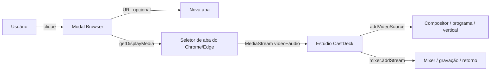

# Fonte Browser — estudo VDO.Ninja + plano EGM

> **Status:** plano + primeira implementação local em 1.4.2 (fonte Browser com Edge headless, 4K e presets). O BrowserHost CEF OSR nativo ainda **não** está implementado.
> **Data:** 2026-11-06.
> **Objetivo final:** fonte **Browser** com navegador CEF real, 720p/1080p/4K, 30 fps mínimo, áudio e qualidade da mesa.

---

## 1. Como o “share website” do VDO.Ninja funciona

O nome “website” do VDO.Ninja engana. Há três caminhos diferentes:

| Recurso do VDO.Ninja | O que é | Gera vídeo da página? |
|---|---|---|
| `&website` / `&iframe` | Compartilha uma **URL**; cada viewer carrega a página num iframe local | **Não**; não há captura da página |
| Screen Share (`&screenshare`, `&prefercurrenttab`) | `getDisplayMedia` captura tela/aba/janela | Sim, a partir do MediaStream |
| Video Capture Extension | Extensão captura `<video>`/aba e publica via SDK WebRTC | Sim |

### 1.1 O caminho do `&website`

Código do VDO.Ninja (branch `develop`):

1. `main.js:2031` detecta `?website=`/`?iframe=` e agenda `session.publishIFrame(url)`.
2. `lib.js:28045` (`session.publishIFrame`) cria um `<iframe>` com o URL, permissões
   `autoplay;camera;microphone;fullscreen;picture-in-picture;display-capture;midi;screen-wake-lock`,
   atributos de segurança (`crossorigin`, opcionalmente `credentialless`) e o insere no `gridlayout`
   do próprio publicador.
3. `webrtc.js:4297` (`session.seedStream`) anuncia a transmissão no servidor de sinalização.
4. `webrtc.js:15853` (`session.initialPublish`) envia aos viewers uma mensagem de controle
   `data.iframeSrc = session.iframeSrc` pelo canal de dados WebRTC.
5. `webrtc.js:8966` recebe `msg.iframeSrc` no viewer e chama `loadIframe(msg.iframeSrc, ...)`;
   o viewer cria **o próprio iframe** e carrega a página.

Ou seja: o WebRTC transporta **a URL e mensagens de sincronização**, não os pixels da página.
O vídeo do site é renderizado localmente por cada viewer; o publicador não faz screencast.
Não há `getDisplayMedia` nesse modo. O `&prefercurrenttab` é outro recurso (screen share) e
apenas deixa a aba atual como padrão no seletor do Chrome.

### 1.2 Por que isso não vira uma fonte do CastDeck

O compositor do CastDeck desenha pixels num canvas. Um iframe cross-origin:

- não pode ser lido via `drawImage`/`getImageData` (canvas contaminado);
- pode ser bloqueado por `X-Frame-Options`/CSP;
- não entra no `programStream`, gravação, vertical ou NDI.

O share website do VDO funciona para **viewers que carregam o iframe**, não para transformar
a página em vídeo. Para o CastDeck, a fonte Browser precisa de um `MediaStream` de verdade.

### 1.3 Conclusão prática

- **VDO `&website`** = iframe remoto + URL via data channel. Não serve como fonte de vídeo.
- **VDO screen share / extensão** = `getDisplayMedia`/MediaStream + WebRTC. É o caminho útil.
- Para o CastDeck local, a opção mais simples é **capturar a aba com `getDisplayMedia`** e
  entregar o `MediaStream` ao `addVideoSource`; não é necessário servidor WebRTC.
- Se o objetivo for URL automática sem clique, o caminho não é WebRTC: é renderização headless
  (DskHost) com `canvas.captureStream()`, que é a Fase 3 opcional deste plano.

**Conclusão:** o “share website” do VDO não captura a página; quem captura é o screen share/extension.
O plano abaixo mantém o MVP em captura de aba via `getDisplayMedia`.

---

## 2. Análise REA

Comando executado:

```text
rea-agents analyze-javascript-application public \
  --source-path js/studio/studio.js \
  --source-path js/studio/dsk.js \
  --source-path js/studio/compositor.js \
  --source-path js/studio/ingest.js \
  --format md
```

Evidência: `ev_9d4fd2f5a6bab17457a9a5438eebf79e39bfd8991d3779ae82a174d076c171bf`.

### 2.1 Ponto de entrada das fontes

- **`addVideoSource(id, stream, meta)`** (`public/js/studio/studio.js:1202`) é a única porta de entrada de vídeo no estúdio.
- Recebe um `MediaStream`, cria/atualiza o `<video>`, registra no compositor e no mixer.
- Câmeras locais, câmeras remotas, tela e convidados usam esse mesmo caminho.

**Implicação:** se o Browser produzir um `MediaStream`, ele entra no palco, no programa, na gravação, no vertical, no retorno do convidado e no NDI sem alterar esses módulos.

### 2.2 Captura de tela já existente

- `public/js/studio/studio.js` já usa `getDisplayMedia` para tela do host e de convidados.
- O stream é passado para `addVideoSource` e o áudio para `mixer.addStream`.
- A UI já sabe lidar com fim de track, troca de dispositivo e fonte no palco.

**Implicação:** um Browser baseado em captura de aba reutiliza quase toda a infraestrutura; não precisa de WebSocket, FFmpeg, WHIP, MediaMTX ou navegador headless.

### 2.3 DSK web não é a mesma coisa

- `server/dsk.js` (`DskHost`) já abre um Chromium headless, captura JPEG/PNG/áudio e envia por WebSocket.
- `public/js/studio/dsk.js:220` fixa `N = 2` e o compositor desenha DSK por cima do programa (`compositor.js:781`).
- Esse caminho é ótimo para overlays e páginas não interativas, mas é **overlay**, não uma fonte de palco; e o custo é um navegador headless por DSK.

**Implicação:** o Browser não deve começar pelo DSK headless. Ele pode ser uma fase futura para URLs automáticas, mas o MVP deve usar captura de aba.

### 2.4 Compositor e mixer

- O compositor trabalha com `el`/`MediaStream` por fonte; `comp.upsertSource` já aceita `kind`.
- O mixer adiciona streams por `mixer.addStream(id, stream, {stageKey, ownerId, monitor})`.

**Implicação:** o Browser precisa de um `id` estável (`browser:<id>`), um `kind: 'browser'`, e um canal de áudio próprio (`browser:<id>:audio`).

---

## 3. Opções avaliadas

### A. Captura direta de aba no estúdio (recomendada — MVP)

O usuário escolhe **“Browser”** em **+ Câmeras**. O estúdio:

1. abre uma aba com a URL desejada (opcional);
2. chama `navigator.mediaDevices.getDisplayMedia({ video: { displaySurface: 'browser', frameRate: 30 }, audio: true })`;
3. o usuário escolhe a aba no seletor nativo do Chrome/Edge;
4. o `MediaStream` volta para o estúdio e entra em `addVideoSource`.

**Vantagens**

- é o mesmo caminho do VDO.Ninja screen share;
- não precisa de servidor, headless, WebSocket ou FFmpeg;
- áudio da aba, quando o usuário marcar “compartilhar áudio”, entra no mixer;
- funciona com sites autenticados, YouTube não-DRM, dashboards e páginas que bloqueiam iframe;
- latência baixa e CPU próxima de uma tela compartilhada normal.

**Limitações**

- exige um clique e a escolha da aba no seletor do navegador;
- a aba precisa continuar aberta;
- páginas com DRM podem aparecer pretas;
- não é “automático por URL” (é captura de uma aba escolhida);
- no Chrome, a captura de aba pode ser limitada quando a aba está minimizada; manter a janela viva.

### B. Janela dedicada + WebRTC loopback

Uma janela `/browser-source` abre a URL em um iframe/aba controlada, chama `getDisplayMedia({ preferCurrentTab: true })` e envia o stream ao estúdio por um `RTCPeerConnection` local (signaling por `BroadcastChannel`/`postMessage`).

**Vantagens**

- botão “Compartilhar esta aba” dentro da própria janela;
- visual mais parecido com uma fonte dedicada;
- possibilidade de abrir a URL automaticamente.

**Custos**

- signaling, oferta/resposta, ICE, reconexão e ciclo de vida da janela;
- popup bloqueado, permissão negada, janela fechada;
- cross-origin/iframe e X-Frame-Options continuam limitando a URL;
- não resolve DRM.

**Não vale no MVP.** Só faz sentido se a UX de “abrir e capturar” precisar ser mais guiada.

### C0. Navegador embutido nativo (CEF OSR) — qualidade OBS/vMix

**É o caminho correto se o requisito é “browser de verdade”, 30 fps mínimo e a mesma qualidade da mesa.**

OBS Browser Source e vMix Web Browser usam **Chromium Embedded Framework (CEF)** com renderização
offscreen; o OBS expõe URL, largura/altura, FPS customizado (padrão 30), áudio e “desligar quando
não visível” ([OBS Browser Source](https://obsproject.com/kb/browser-source)). O vMix usa CEF com
URL, width/height, mouse/teclado, transparência, áudio e WebRTC ([vMix Web Browser](https://m.vmix.com/help26/WebBrowser.html)).

#### Arquitetura em Rust

```text
castdeck-browser-host (Rust, processo nativo)
  ├── CefRuntime (execute_process_from no main, antes de threads)
  ├── CefBrowser OSR por fonte (windowless, 30/60 fps, até 3840×2160)
  ├── frame GPU (shared texture / IOSurface / DMABUF)
  ├── encoder de hardware (NVENC/QSV/AMF/VideoToolbox; fallback libx264)
  ├── CefAudioHandler → Opus/AAC
  ├── WHIP (ou SRT/RTMP) → MediaMTX
  └── IPC com o servidor Node (criar/fechar/reload/interagir, métricas)

Node server
  └── spawn/supervise castdeck-browser-host
        └── estúdio recebe WHEP como fonte normal (addVideoSource)
```

- **CEF em Rust:** usar `tauri-apps/cef-rs`/`cef-dll-sys` como base; se o binding de OSR
  acelerado não estiver maduro no spike, manter o núcleo CEF em C++ e a orquestração/IPC/encoder
  em Rust. Rust é a escolha para processo, shared memory, supervisão, métricas e protocolo; CEF
  continua sendo C++ por baixo.
- **Subprocessos CEF:** no Windows/Linux o CEF reexecuta o binário; `execute_process_from` deve ser
  a primeira chamada do `main`, antes de winit/tokio/qualquer thread. No macOS, helpers do bundle
  chamam `run_subprocess`.
- **Frame path:** não usar JPEG. Textura GPU → encoder de hardware, sem round-trip de CPU. Se o
  backend não suportar textura compartilhada, `OnPaint` BGRA + encoder CPU entra como fallback
  explicitamente marcado como “modo compatibilidade”.
- **Transporte:** WHIP direto para o MediaMTX é o preferido (baixa latência, H.264/Opus, sem
  transcodificar); SRT/RTMP ficam como fallback se o WHIP não estabilizar.
- **Real-time:** CEF OSR roda no ritmo da mesa; o encoder publica continuamente; o estúdio recebe
  por WHEP e compõe no canvas. Latência alvo: **≈150–300 ms** fonte → programa, a medir.
- **Ciclo de vida:** um processo `browser-host` compartilhado; uma página/contexto por fonte;
  cria ao entrar no palco/programa, fecha ao remover; crashes isolados por renderer.
- **Interação:** mouse/teclado via CEF no modo “Interagir”; sem capturar teclado global.
- **Transparência:** H.264/HEVC não têm alpha. Páginas transparentes continuam no DSK (PNG/alpha)
  ou em uma saída RGBA separada; o Browser normal é opaco.

#### C0.1 Qualidade e mesa (720p, 1080p e 4K)

**O 4K é um preset da mesa, não um “modo 4K” separado do Browser.** O Browser herda a resolução/FPS
da mesa; a mesa é quem precisa aceitar 4K no programa, switching, gravação e transmissão.

O Browser source segue **o preset da mesa**, incluindo 720p. Nada de resolução fixa.

| Preset da mesa | Viewport da fonte | Programa | Fonte (1,5–2×) |
|---|---:|---:|---:|
| **720p30** | 1280×720 @ 30 | 4,5 Mbps | 7–9 Mbps |
| **720p60** | 1280×720 @ 60 | 6 Mbps | 9–12 Mbps |
| **1080p30** | 1920×1080 @ 30 | 6 Mbps | 9–12 Mbps |
| **1080p60** | 1920×1080 @ 60 | 9 Mbps | 14–18 Mbps |
| **2160p30** | 3840×2160 @ 30 | 25–35 Mbps | 40–70 Mbps |
| **2160p60** | 3840×2160 @ 60 | 45–60 Mbps | 70–110 Mbps |

- **FPS:** igual ao preset, **mínimo 30**; 60 quando a mesa estiver em 60.
- **Fonte:** H.264 High (ou HEVC/AV1 se encoder e WHEP suportarem), yuv420p, keyframe ~1 s.
- **Encode final:** o encoder da mesa não muda; há um encode extra da fonte.
- **Sem JPEG, sem downscale, sem `captureStream` de 30 fps de quadro parado.**
- **Troca de preset:** reconfigura viewport/FPS/bitrate do BrowserHost. 720p/1080p são obrigatórios;
  4K30 é o alvo; 4K60 só com headroom comprovado.
- **720p não é modo degradado:** é um preset de saída normal e precisa de 30/60 fps, áudio e
  qualidade equivalente aos demais presets.

#### C0.2 Suporte a 4K na mesa

**O requisito principal é a mesa aceitar 2160p**: programa, switching, overlays, gravação,
transmissão, NDI e previews. O Browser source é consequência: quando a mesa está em 4K, ele herda
o viewport 4K (ou 1080p com upscale avisado se o hardware não acompanhar).

Os presets **720p30/720p60/1080p30/1080p60 já existem** e não podem regredir.

| Item | Mudança |
|---|---|
| Presets | `2160p30` e `2160p60` em `server/broadcast.js` |
| Bitrate | 2160p30 ~25–35 Mbps; 2160p60 ~45–60 Mbps |
| Canvas | `comp` em 3840×2160; previews podem reduzir, programa não |
| Switching | prévia e programa em 4K; transições/FTB/solo sem perda de resolução |
| Overlays/DSK/GC | desenhar em 4K; reavaliar custo de DSK web e legendas |
| Browser source | herda 4K quando o preset é 4K; 1080p + upscale com aviso se faltar GPU |
| Encoder | confirmar NVENC/QSV/AMF/VideoToolbox em 4K; fallback x264 com aviso |
| MediaRecorder/WebM | 4K30 pode exigir WebCodecs; medir antes de prometer 4K60 |
| Gravação | MP4 4K; espaço em disco e limite de rotação |
| NDI | saída 4K quando o preset for 4K; checar limite/qualidade |
| Vertical | 2160×3840 apenas se o hardware validar; caso contrário, vertical fica em 1080×1920 |
| MediaMTX/WHEP | H.264 4K; browser precisa decodificar em hardware |

**4K30 é o alvo mínimo viável**; 4K60 é condicionado ao spike de GPU/encode/decode. Não prometer
4K60 em máquina sem hardware.

**Aceite da mesa 4K:** gravar e transmitir em 3840×2160@30, com switching, overlays, GC/DSK,
áudio e NDI funcionando; 4K60 só entra se o teste de soak passar.

#### Orçamento esperado (medir no spike)

| Cenário | RAM | CPU/GPU |
|---|---|---|
| Fonte fora do palco / página fechada | ~0 | ~0 |
| **720p30**, página simples | 180–300 MB (CEF + aba) | 5–10% de um núcleo + GPU |
| **720p60**, página com vídeo | 250–400 MB | 8–15% + GPU |
| 1080p30, página simples | 300–500 MB | 10–20% + GPU |
| 1080p60, página com vídeo | 400–700 MB | 20–35% + GPU |
| 4K30, página simples | 600–900 MB | 20–35% + GPU |
| 4K60, página com vídeo | 800–1400 MB | 35–60% + GPU |
| 2 fontes 1080p30 | 600–900 MB | 25–45% + GPU |

Isso **não é “extremamente leve”**; é o custo de um browser real em tempo real. A economia vem de
compartilhar o processo, abrir sob demanda, usar textura GPU e não usar JPEG.

#### Riscos

- CEF é uma dependência nativa grande (~100–200 MB por plataforma) e exige build/assinatura por SO.
- OSR acelerado tem diferenças por plataforma; validar Windows, Linux e macOS.
- O caminho textura GPU → encoder de hardware é o maior risco técnico do spike.
- 4K60 pode não fechar em GPU intermediária; 4K30 é o compromisso.
- Um encode extra por fonte consome GPU; limite de 1 fonte 4K, 2 fontes 1080p ou 3 fontes 720p.
- Páginas com DRM continuam limitadas; login/cookies exigem perfil isolado.
- Input/interação e áudio CEF são mais complexos que o headless atual.

#### Estimativa

- **Spike técnico (obrigatório):** 4–6 dias — CEF OSR em Rust, textura GPU, encode, áudio,
  WHEP, 1080p30 e 4K30, métricas.
- **Implementação utilizável:** 4–6 semanas, incluindo presets 4K, empacotamento por SO,
  ciclo de vida, interação, testes e regressão dos DSKs.
- **4K60:** +1–2 semanas somente se o spike provar headroom.

#### C0.3 Arquivos previstos (CEF + 4K)

| Arquivo | Mudança |
|---|---|
| `native/browser-host/` (Rust) | CEF runtime, OSR, frames GPU, áudio, encoder, WHIP, IPC, métricas |
| `native/browser-host/Cargo.toml` | `cef`/`cef-dll-sys` (ou IPC para núcleo C++), encoder e transporte |
| `server/browser-source.js` | spawn/supervisor do helper, API de criar/fechar/reload/interagir e status |
| `server/broadcast.js` | presets `2160p30`/`2160p60` e bitrates de 4K |
| `server/index.js` | rotas `/api/browser/*`; estado do helper em `/api/system` |
| `public/js/studio/studio.js` | opção **Browser** no menu + Câmeras; persistência; fonte |
| `public/js/studio/browser-ui.js` | modal URL, preview, Interagir, Recarregar, Parar, erro |
| `public/js/studio/audio-ui.js` | canal de áudio do Browser dinâmico |
| `build/build-exe.mjs` | empacotar `browser-host` + CEF por SO; assinatura |
| `test/browser-source-e2e.mjs` | E2E local com URL de teste, 1080p30/4K30 e queda do helper |

#### C0.4 Rust: onde faz sentido

- **Sim:** processo helper, supervisão, IPC, ring buffer, métricas, ciclo de vida, encoder wrapper,
  protocolo de controle e recuperação de crash.
- **Não:** reescrever o compositor ou o servidor Node; o CEF continua C++ por baixo.
- **Bindings:** avaliar `cef-rs`/`cef-dll-sys`; se o OSR acelerado não estiver utilizável, usar
  núcleo CEF em C++ e manter Rust como host/IPC/encoder. O spike decide.
- **Crates a avaliar no spike:** `cef`, `cef-dll-sys`, `wgpu` para interop de textura, `tokio`
  para IPC, `serde`/`bincode` para o protocolo e `tracing` para métricas.
- **Não** adotar dependência nova no produto antes do spike; o plano é avaliação.

### C. Headless no servidor (modo leve/fallback)

O servidor renderiza a URL no Chromium headless, converte os quadros em JPEG/PNG e envia por WebSocket; o cliente desenha num canvas e cria `canvas.captureStream()`.

**Vantagens**

- URL automática, sem interação;
- reutiliza `DskHost` e a infraestrutura de páginas web já testada;
- pode ser **muito leve** se for sob demanda e com um único navegador compartilhado.

**Custos**

- um navegador headless **por fonte** no desenho atual do DskHost (CPU/RAM);
- captura por screenshot/JPEG, latência maior (≈100–300 ms), não é vídeo contínuo;
- sites com DRM, login, anti-bot ou vídeo protegido podem falhar;
- não é WebRTC de verdade; é um MediaStream sintético.

### C.1 Dá para ficar “extremamente leve”?

**Sim, se o escopo for restrito.** Um navegador é caro por natureza; o que dá para eliminar é o desperdício:

| Medida | Efeito |
|---|---|
| Navegador **compartilhado** com abas, em vez de um processo por fonte | economiza ~100–200 MB de base por fonte |
| Criar a página só quando a fonte está no palco/programa e **fechar quando sai** | 0% de CPU/RAM fora do ar |
| **Uma** fonte automática por vez (máximo 2 em modo leve) | evita 3–4 Chromiums |
| Captura em **720p, 5–15 fps, JPEG q60**, só quando o quadro muda | reduz decode, banda e composição |
| `canvas.captureStream(0)` + `requestFrame()` por quadro novo | não reenvia 30 fps de quadro parado |
| Sem áudio por padrão; áudio só com opt-in | evita captura/encode de áudio |
| Pausar quando o app está minimizado ou a fonte está fora do palco | mantém o custo perto de zero em idle |
| Reutilizar o mesmo navegador dos DSKs | não soma duas pilhas de Chromium |

**Orçamento realista** (medir na implementação, não prometer antes):

| Cenário | RAM aprox. | CPU aprox. |
|---|---|---|
| Fora do palco / página fechada | 0 | 0% |
| Página estática 720p, 5 fps | 120–220 MB (navegador + aba) | 1–4% de um núcleo |
| Página animada 720p, 15 fps | 180–300 MB | 4–10% de um núcleo |
| Página 1080p30 com vídeo | 300–500 MB | 10–25% de um núcleo |

Ou seja: **“extremamente leve” para painel/placar/relógio é viável; para vídeo 1080p30 arbitrário, não.** O limite é o próprio navegador.

### C.2 Outro navegador ajuda?

| Engine | Prós | Contras | Decisão |
|---|---|---|---|
| **CEF nativo (OSR)** | engine do OBS/vMix, 30/60 fps, áudio e interação | dependência nativa grande e build por SO | **recomendado para qualidade** |
| **Electron offscreen** | OSR mais fácil, cross-platform | runtime extra pesado; não é a melhor integração | protótipo, não final |
| **WebView2** (Windows) | usa Edge instalado, binário menor | só Windows; quebra paridade Linux/macOS | opcional, não base |
| **WebKitGTK** (Linux) | nativo no Linux | APIs de captura diferentes; sem paridade | não |
| **WKWebView** (macOS) | nativo no macOS | só macOS; captura via CDP não existe | não |
| **Ultralight** | leve no papel | licença comercial, web moderna limitada | não |
| **Servo** | experimental | compatibilidade insuficiente | não |
| **wkhtmltoimage** | leve | engine antiga, sem JS moderno/vídeo | não |

**Conclusão:** para a experiência “OBS/vMix” com 30 fps e qualidade de mesa, **CEF OSR (C0)** é a
única opção fiel. O Chromium/Edge headless compartilhado fica como **modo leve/fallback** para
painéis estáticos; WebView2 não mantém paridade entre os desktops.

### C.3 Desenho leve proposto

```text
BrowserHost (singleton)
  └── 1 processo Edge/Chromium headless
        ├── browser context da fonte A (aba)
        └── browser context da fonte B (aba, somente se modo leve permitir)

Fonte no palco:
  Page.startScreencast(720p, 5–15 fps, JPEG q60)
    → WebSocket binário
    → canvas offscreen
    → captureStream(0) + requestFrame()
    → addVideoSource('browser:<id>')

Fonte fora do palco:
  Page.stopScreencast()
  → fecha a aba após 5–10 s
  → processo principal fica ocioso (ou é encerrado se nenhum DSK usar)
```

Regras de produto:

- **1 fonte automática ativa** por padrão; no máximo **2** com aviso de consumo;
- a fonte só abre navegador quando está no palco/programa ou na prévia;
- ao sair do palco, fecha a aba e libera memória;
- se a URL exigir login/DRM, cair para o modo **captura de aba** (manual);
- se o site bloquear headless, mostrar “use a captura de aba”;
- o modo automático não é WebRTC e deve ser rotulado assim na UI.

**Custo de implementação:** +3–5 dias sobre o MVP, incluindo o refactor do DskHost para navegador compartilhado e testes de regressão dos DSKs.


### D. Extensão/Electron Capture

Uma extensão captura `<video>`/aba e publica via WebRTC, como o VDO Capture Extension.

**Custo:** instalação de extensão, permissões, manutenção por navegador. **Fora do escopo** de uma fonte nativa do CastDeck.

---

## 4. Decisão recomendada

**Produto final:** opção **C0 — navegador embutido nativo em CEF OSR**, com **30 fps mínimo**,
resolução e qualidade seguindo a mesa, áudio no Mixer e interação mouse/teclado. É o caminho fiel
ao OBS Browser Source/vMix Web Browser. **O 4K é requisito da mesa**; o Browser apenas herda o preset
quando a mesa estiver em 4K.

**Modo rápido/fallback:** opção **A — captura de aba via `getDisplayMedia` + MediaStream**, para
quando o CEF não estiver disponível ou o usuário precisar de uma página autenticada/DRM sem
renderização nativa.

**Modo leve opcional:** opção **C — headless CDP**, apenas para painéis estáticos; não atende
30 fps/qualidade de mesa e não deve ser vendido como browser source completo.

O Browser “de verdade” não será um iframe; será um navegador CEF renderizando a URL e entregando
vídeo/áudio ao pipeline normal do estúdio.

---

## 5. Arquitetura do modo rápido (fallback)

### 5.1 Fluxo do usuário

```text
+Câmeras → Browser
  → modal: URL opcional + resolução/fps/áudio
  → “Abrir e escolher aba” (gesto do usuário)
  → window.open(url) [opcional]
  → getDisplayMedia({displaySurface:'browser', audio:true})
  → usuário escolhe a aba
  → addVideoSource('browser:<id>', stream, {kind:'browser'})
  → mixer.addStream('browser:<id>:audio', audioOnly, ...)
  → tile no backstage + palco
```

### 5.2 Diagrama



### 5.3 Contrato da fonte

```js
// id estável, persistido no estúdio
'browser:<id>'

// estado em memória
{
  id: 'browser:abc123',
  kind: 'browser',
  label: 'Browser — Dashboard',
  stream: MediaStream,
  el: HTMLVideoElement,
  audioId: 'browser:abc123:audio',
  hasAudio: true,
  url: 'https://...',        // apenas histórico/reabertura
  createdAt: 1762...
}
```

### 5.4 Persistência

Adicionar ao schema do estúdio:

```json
{
  "browserSources": [
    {
      "id": "abc123",
      "label": "Dashboard",
      "url": "https://exemplo.com/painel",
      "width": 1920,
      "height": 1080,
      "fps": 30,
      "audio": true
    }
  ]
}
```

Regras:

- salvar **configuração**, nunca o MediaStream nem o conteúdo da página;
- ao abrir o estúdio, a fonte aparece como “Browser — reconectar” e **não** abre captura sozinha;
- o usuário clica em **Reabrir captura** para chamar `getDisplayMedia` de novo;
- ao remover a fonte, parar tracks e remover o canal do mixer;
- migração: estúdios antigos sem `browserSources` começam com lista vazia.

### 5.5 Arquivos previstos

| Arquivo | Mudança |
|---|---|
| `public/js/studio/browser-source.js` | novo módulo: modal, captura, tracks, ciclo de vida e tile |
| `public/js/studio/studio.js` | importar o módulo, opção no `openAddCamera`, chamada em `addVideoSource`, remoção no cleanup |
| `public/js/studio/audio-ui.js` | listar canal de áudio do Browser dinamicamente |
| `server/store.js` / `server/index.js` | aceitar `browserSources` no schema do estúdio e validar no PUT |
| `public/js/studio/studio.js` (persistência) | serializar/restaurar apenas a configuração |
| `test/browser-source-e2e.mjs` | teste CDP com getDisplayMedia falso (canvas) |

Nenhum arquivo de servidor de mídia/FFmpeg é necessário no MVP.

---

## 6. EGM — seis lentes

| Lente | Decisão |
|---|---|
| **Segurança** | CEF sandbox, perfil isolado, apenas `http(s)`, sem `file://`/`javascript:`, sem reutilizar cookies do painel; page pode acessar a rede local como um browser normal — avisar e permitir allowlist; validar URL e origem; input só no modo Interagir |
| **Privacidade** | página renderiza no processo nativo; cookies/cache no perfil do BrowserHost; permitir perfil efêmero e limpar ao remover; áudio/frames ficam locais, sem nuvem |
| **Confiabilidade** | watchdog de CEF/renderer, timeout de carregamento, crash sem derrubar o programa, áudio/track `ended`, reconectar/recarregar, GPU fallback CPU |
| **Performance** | 30 fps mínimo na resolução da mesa; 60 quando preset 60; **mesa 4K30** com 4K60 condicional; Browser herda 4K ou 1080p+upscale; máximo 1 fonte 4K, 2×1080p ou 3×720p; criar sob demanda e fechar ao sair |
| **UX** | URL, largura/altura, FPS herdado da mesa, áudio, **Interagir**, recarregar, voltar/avançar, preview, erro claro; source igual às câmeras |
| **Custo/licença** | CEF é BSD; aumenta o pacote em ~100–200 MB por SO; build/assinatura por plataforma; não usar SDK do VDO nem runtime externo |

### 6.1 Segurança detalhada

- A URL é renderizada pelo CEF no host; isso é um browser real e pode acessar a rede local. Não é SSRF de servidor, mas é acesso de rede a partir da máquina do usuário.
- Bloquear esquemas não-HTTP(S); não aceitar `file://`, `javascript:` ou `data:`.
- CEF com **sandbox**, perfil de dados separado do painel e, idealmente, **perfil efêmero** por fonte.
- Não compartilhar cookies/sessão do CastDeck com a página.
- Permissões de câmera/mic/localização negadas por padrão; liberar só com ação explícita.
- Mouse/teclado apenas no modo **Interagir**.
- DRM: a página pode renderizar preto; documentar, não contornar.
- Não abrir fonte automaticamente ao carregar o estúdio; só ao colocar no palco/programa ou por ação do usuário.

### 6.2 Falhas e recuperação

| Falha | Comportamento |
|---|---|
| URL inválida | modal recusa; nada é criado |
| Página não carrega/timeout | fonte mostra erro e botão **Recarregar** |
| Renderer CEF cai | helper reinicia a página; programa continua; limite de tentativas |
| GPU/OSR falha | fallback para `OnPaint` CPU; aviso de performance |
| Sem áudio | fonte entra muda; Mixer mostra “sem áudio” |
| Fonte sai do palco | fecha a página após alguns segundos; libera RAM |
| Troca de preset (720p/1080p/60) | reconfigura viewport/FPS sem recriar a fonte |
| DRM/anti-bot | mensagem “use captura de aba” |

---

## 7. Fases e estimativa

### Fase 0 — Spike CEF OSR (obrigatório antes de prometer)

- CEF windowless em **1280×720 e 1920×1080**, 30 e 60 fps, com página real;
- 4K apenas se a mesa 4K já estiver no escopo imediato;
- `OnPaint`/textura compartilhada, encode H.264 por hardware, áudio e WHIP;
- medir CPU/GPU/RAM, latência e frames perdidos;
- validar Rust (`cef-rs`) versus núcleo C++ com IPC Rust;
- testar Windows, Linux e macOS.

**Estimativa:** 4–6 dias. **Gate:** se não entregar **720p30/60 e 1080p30/60** estáveis, rever arquitetura antes de codificar o produto.

### Fase 0.5 — Mesa 4K

Trabalho separado da fonte Browser; é o que o usuário pediu como “mesa aceitar 4K”:

- presets `2160p30`/`2160p60`;
- canvas 3840×2160 e switching/prévia em 4K;
- overlays/GC/DSK e legendas em 4K;
- encoder/bitrate 4K;
- gravação MP4 4K e transmissão 4K;
- NDI 4K;
- teste de soak de 30–60 min.

**Estimativa:** 1–2 semanas. 4K60 condicional ao hardware.

### Fase 1 — Browser source CEF

- helper nativo `browser-host` compartilhado (CEF + OSR + encoder);
- uma página por fonte, criada sob demanda;
- render na resolução/FPS da mesa: **720p30/60, 1080p30/60 e, quando a mesa for 4K, 4K30/60**;
- H.264 de fonte com bitrate alto + áudio CEF;
- publicação em MediaMTX via WHIP (fallback SRT/RTMP) e leitura WHEP;
- integração com `addVideoSource`, Mixer, palco, vertical, gravação e NDI;
- UI: modal URL, preview, “Interagir”, “Recarregar”, “Parar”;
- lifecycle: abre no palco/programa, fecha ao remover; limite de 1 fonte 4K, 2 fontes 1080p ou 3 fontes 720p.

**Estimativa:** 4–6 semanas, incluindo empacotamento por SO e testes de regressão dos DSKs.

### Fase 1.1 — Browser 4K / 4K60 (condicional)

- só depois da mesa 4K e do spike provarem headroom de GPU/encode/decode;
- se não fechar, Browser em 4K cai para 1080p + upscale com aviso, e 4K30 permanece o alvo da mesa.

**Estimativa:** +1–2 semanas.

### Fase 2 — Fallback de captura de aba

- módulo `browser-source.js` com `getDisplayMedia`;
- útil onde CEF não estiver disponível ou para página autenticada/DRM;
- 1–2 dias sobre a base existente.

### Fase 3 — Headless CDP leve (opcional)

- modo “painel estático”, 720p/5–15 fps, sem compromisso de qualidade de vídeo;
- não substitui o CEF; serve para URL automática de baixo custo.

**Estimativa:** +3–5 dias, incluindo refactor do DskHost e regressão dos DSKs.

---

## 8. Critérios de aceite da fonte Browser (CEF)

1. **+ Câmeras → Browser** aceita URL e abre uma página CEF real.
2. **A mesa aceita 4K30** (3840×2160) em programa, switching, gravação, transmissão e NDI.
3. O Browser renderiza **720p30/60 e 1080p30/60** obrigatoriamente; quando o preset da mesa é 4K, herda 4K30 ou usa 1080p + upscale com aviso se faltar GPU.
4. O FPS efetivo acompanha a mesa; sem queda para 5–15 fps em conteúdo animado.
5. 4K60 só é aceito se o spike provar GPU/encode/decode; caso contrário, 4K30 é o limite da mesa.
6. Áudio CEF entra no Mixer com fader/mute e acompanha o palco.
7. Fonte entra no palco, programa, vertical, gravação, transmissão, retorno e NDI.
8. Mouse/teclado funcionam no modo **Interagir**.
9. A página abre ao entrar no palco/programa e fecha ao sair; fonte removida libera CEF.
10. A qualidade visual acompanha a mesa: sem JPEG intermediário; H.264 de fonte em bitrate alto.
11. Windows, Linux e macOS têm a mesma fonte (com fallback CPU de OSR onde não houver textura).
12. Medir CPU/GPU/RAM por cenário e respeitar o limite de 1 fonte 4K, 2 fontes 1080p ou 3 fontes 720p.
13. Falha de CEF/URL não derruba o programa; UI mostra reconectar/erro.
14. Android não mostra a opção.
15. Fallback de captura de aba continua disponível quando CEF/login/DRM bloquear.

---

## 9. Não objetivos

- Não é um navegador embutido no painel.
- Não é iframe desenhado no canvas (CORS/X-Frame-Options).
- Não substitui o DSK web; DSK continua sendo overlay.
- Não captura DRM.
- Não abre captura sozinho ao carregar o estúdio.
- Não usa SDK do VDO.Ninja nem servidor externo.

---

## 10. Implementação local 1.4.2 (parcial, sem publicar)

Esta primeira entrega local **não é o CEF OSR**. É uma fonte Browser funcional baseada no
Edge headless/CDP que já existia no DSK, para validar o fluxo de fonte, 4K e presets.

### O que foi implementado

- presets **2160p30** e **2160p60** no servidor, com 30/55 Mbps;
- opções de bitrate 25/35/50 Mbps na UI;
- opção **Browser** em **+ Câmera**;
- URL, resolução/FPS seguindo o preset da mesa (720p/1080p/4K);
- frames do Edge headless via `/dsk` → canvas → `captureStream(0)` + `requestFrame()`;
- áudio da página no Mixer como canal `browser:<id>:audio`;
- até 2 Browsers em 720p/1080p ou 1 em 4K;
- persistência de label/URL em `S.brand.browserSources`;
- source entra no palco, programa, vertical, gravação e NDI como qualquer fonte;
- lixeira visível na miniatura do Browser;
- painel **Interagir**: prévia ao vivo, clique/arraste, teclado, envio de texto, URL e recarregar;
- menu de ações da miniatura também abre com **botão direito**.

### Limitações desta entrega

- **não é CEF OSR**: é Edge headless + JPEG, com uma janela por Browser;
- qualidade/latência ainda não é a do OBS/vMix; o caminho de frames usa JPEG;
- a interação cobre clique/teclado/texto/URL; voltar/avançar e atalhos globais ainda não;
- 4K30 de gravação foi validado (~48 fps de encode no teste local), mas o Browser 4K
  concorre com o encode da mesa;
- CEF nativo, textura GPU, áudio CEF e 30/60 fps com qualidade de mesa continuam na Fase 1.

### Arquivos

- `public/js/studio/browser-source.js` — módulo da fonte;
- `public/js/studio/studio.js` — menu, init, persistência e remoção;
- `public/js/studio/audio-ui.js` — canal BROWSER no Mixer;
- `server/broadcast.js` — presets 4K;
- `server/dsk.js` — reaproveitado como renderizador headless.

---

## 10.1 Spike CEF local (2026-11-07)

- Spike Windows em `native/browser-host-cef` com **CefSharp 156 OffScreen/.NET 8**.
- Renderiza URL real em **1280×720 e 3840×2160** e grava JPEGs; prova o caminho CEF OSR.
- Medido: ~27,8 fps em 720p e ~20 fps em 4K no OSR de CPU; página estática só repinta quando há dano.
- **Shared texture/D3D11 + TurboJPEG** integrada ao servidor (`/cef`) e à fonte Browser no Windows: 720p ~50 fps no cliente e helper 4K ~55 fps.
- 4K no cliente com ImageDecoder ficou em ~32 fps no teste headless; 4K30 atingido.
- Clique, texto e áudio CEF funcionam (float** → PCM16 48 kHz); helper self-contained incluído no instalador local de teste.
- O modo Edge headless da 1.4.2 continua sendo o usado em produção.

## 11. Referências

- VDO.Ninja — `&website`: https://docs.vdo.ninja/advanced-settings/setup-parameters/and-website.md
- VDO.Ninja — `&prefercurrenttab`: https://docs.vdo.ninja/advanced-settings/screen-share-parameters/and-prefercurrenttab.md
- VDO.Ninja — captura sem browser sources: https://docs.vdo.ninja/guides/capturing-without-browser-sources
- VDO.Ninja Video Capture Extension: https://github.com/steveseguin/video_capture_extension
- VDO.Ninja — implementação `publishIFrame`: https://github.com/steveseguin/vdo.ninja/blob/develop/lib.js
- VDO.Ninja — envio/recepção de `iframeSrc`: https://github.com/steveseguin/vdo.ninja/blob/develop/webrtc.js
- OBS Browser Source (CEF, URL, FPS 30, áudio): https://obsproject.com/kb/browser-source
- vMix Web Browser (CEF, URL, mouse/teclado, áudio): https://m.vmix.com/help26/WebBrowser.html
- CEF — Chromium Embedded Framework: https://github.com/chromiumembedded/cef
- Chrome screen sharing controls: https://developer.chrome.com/docs/web-platform/screen-sharing-controls/

**NDI® é marca registrada da Vizrt NDI AB.**
